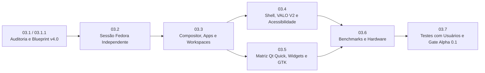

# Plano Técnico de Implementação — SYSTALIA Alpha 0.1 (Etapa 03)

**Alinhado a:** [`SGE_MASTER_BLUEPRINT.md`](SGE_MASTER_BLUEPRINT.md) v4.0  
**Pacote de contexto:** [`Context/README.md`](Context/README.md)  
**Repositório:** `LucasRamosSilva-15/systalia-glass-engine`  
**Branch e commit de referência:** `valo-graphics-2.0` @ `c8e4912`  
**Objetivo:** orientar a implementação incremental, os testes em sessão real e a homologação da **SYSTALIA Alpha 0.1**, substituindo o antigo plano focado exclusivamente no redesign Figma de outubro de 2026.

> **Regra de estado:** nenhuma atividade abaixo pode ser marcada como **homologada** apenas com testes `offscreen`, capturas sintéticas ou leitura de código. Cada atividade exige evidências reproduzíveis no ambiente alvo.

---

## 1. Visão geral da sequência técnica (03.1 → 03.7)

---

## 2. Detalhamento das atividades (03.1 a 03.7)

### Atividade 03.1 — Auditoria e inventário técnico
- **Dependências:** Conclusão das Etapas 01 e 02 (`Context/`).
- **Requisitos envolvidos:** `RNF-07` (reprodutibilidade), governança `02.6`.
- **O que já existe:**
  - Auditoria inicial 03.1 registrada em [`Context/ETAPA_03_ESTADO_E_PROXIMAS_ACOES.md`](Context/ETAPA_03_ESTADO_E_PROXIMAS_ACOES.md).
  - Auditoria detalhada do código real e modernização documental para v4.0 concluídas nesta Etapa **03.1.1** (`SGE_MASTER_BLUEPRINT.md` e este plano).
  - Baseline técnico herdado da Consolidação `06.6E`: árvore organizada (`src/`, `tests/`, `tools/`, `cmake/`, `shaders/v2/`, `assets/figma/`), 48 alvos CTest e 25 `.qsb`.
- **O que falta:** manter inventário sincronizado caso ocorram mudanças antes da 03.2.
- **Critérios de aceitação:** documentação v4.0 coerente com `Context/` e com o código real no HEAD, sem referências obsoletas ao renderer V1 ou caminhos antigos.
- **Testes necessários:** verificação documental de consistência de símbolos, caminhos e contratos contra o repositório.
- **Riscos:** divergência se alterações de código ocorrerem sem atualização de `docs/`/`Context/`.
- **Evidências esperadas:** `SGE_MASTER_BLUEPRINT.md` v4.0 e `SGE_IMPLEMENTATION_PLAN.md` atualizados e commitados.
- **Condição de conclusão:** **Concluída com a entrega da Etapa 03.1.1.**

---

### Atividade 03.2 — Sessão Fedora independente
- **Dependências:** 03.1 / 03.1.1.
- **Requisitos envolvidos:** `RF-01` (P0), `RNF-01`, `RNF-05`, `RNF-07`, decisão `02.2-B` (Fedora como referência).
- **O que já existe:**
  - `InputDeviceManager::evaluatePlatformEnvironment` e `configureProcessPlatformEnvironment` (`eglfs_kms` + `vulkan`).
  - `LogindSessionService` (`org.freedesktop.login1.Session`: `TakeControl`, `TakeDevice`, `PauseDevice`/`ResumeDevice`) e conexão `gpuSubmissionSuspendedChanged` em `src/app/main.cpp`.
  - `data/systalia-session`, `data/systalia.desktop`, `config/eglfs_kms.json` e `cmake/SgeInstall.cmake`.
  - Testes unitários/mock `tst_input_hardware_backend` e `tst_logind_integration`.
- **O que falta implementar / homologar:**
  - Definir edição e versão oficial do **Fedora** de referência para a Alpha 0.1.
  - Resolver risco de caminho relativo `"config/eglfs_kms.json"` em `src/app/main.cpp` (resolução em diretório instalado/XDG além do CWD).
  - Validar caminhos de instalação em `data/systalia-session` e `data/systalia.desktop` (`/usr/bin` vs prefixos configuráveis / empacotamento RPM).
  - Testar login real via SDDM/TTY, aquisição de DRM/KMS e `libinput`, troca de VT (`Ctrl+Alt+F*` com pausa/retomada de GPU), encerramento limpo e recuperação de falha.
- **Critérios de aceitação:** usuário inicia sessão Fedora autônoma pelo gerenciador de login ou TTY, interage com teclado/mouse físicos, alterna VT e retorna sem travamento de GPU ou perda de entrada, e encerra a sessão limpamente.
- **Testes necessários:** bateria CTest existente + roteiro manual documentado em hardware/VM Fedora real (fora de modo aninhado).
- **Riscos:** incompatibilidades de driver DRM/Vulkan/EGLFS no Fedora alvo; permissões de dispositivo sem `logind` ativo; conflito com `config/eglfs_kms.json` ausente no diretório de trabalho.
- **Evidências esperadas:** especificação da edição Fedora + spec/guia de instalação reproduzível + logs de `logind`/DRM/input de sessão independente real.
- **Condição de conclusão:** sessão autônoma inicializa, opera entrada/saída e troca de VT com sucesso em ambiente Fedora real documentado.

---

### Atividade 03.3 — Compositor, aplicações e workspaces
- **Dependências:** 03.2 (sessão independente operacional).
- **Requisitos envolvidos:** `RF-02`, `RF-03`, `RF-04`, `RF-09` (P0), `RNF-01`, `RNF-06`.
- **O que já existe:**
  - `SystaliaCompositor`, `WindowStackModel`, `OutputManagerService`, `SystaliaSurfaceExtension` (`z_systalia_surface_v1`).
  - `WaylandWindowContainer.qml` com `ShellSurfaceItem` direto, SSD `ValoMaterialSurfaceV2`, resize 8 bordas, minimizar/maximizar/fechar.
  - `WorkspaceManagerService` (4 workspaces, atalhos `Super+*`, culling) e `LiquidTilingService` (snap magnético e `TileSplitter`).
- **O que falta implementar / homologar:**
  - Exercitar ciclos longos de abertura, movimentação, resize, maximização, minimização e fechamento com aplicativos reais acelerados por GPU em sessão independente (não apenas `alacritty` em sessão aninhada).
  - Completar funcionalidades mínimas de **workspaces por atividade** aprovadas na Decisão 07 (ex.: nomeação/identificação por atividade e movimentação previsível de janelas sem automações intrusivas).
  - Validar popups, subsurfaces, menus contextuais, diálogos modais e clipboard entre múltiplos clientes Wayland na sessão real.
  - Verificar comportamento com mudança de escala/resolução e documentar limites de multi-monitor se aplicável.
- **Critérios de aceitação:** zero crashes ou travamentos críticos em sessão prolongada de desenvolvimento; foco, empilhamento MRU, teclado, mouse, popups, clipboard e workspaces por atividade funcionando de forma previsível.
- **Testes necessários:** CTest (`tst_xdg_*`, `tst_systalia_protocol`, `tst_workspace_manager`, `tst_liquid_tiling`, `tst_wayland_client_lifecycle_e2e`, `tst_shell_state_regression`, `tst_client_surface_visibility`) + testes manuais prolongados na sessão Fedora.
- **Riscos:** vazamento de buffers/texturas em clientes reais, perda de foco em popups/diálogos, dessincronização de resize sob carga.
- **Evidências esperadas:** relatório de sessão prolongada com lista de aplicativos executados, logs sem erros fatais e cobertura de todos os fluxos de janela/workspace.
- **Condição de conclusão:** compositor e workspaces estáveis e aprovados nos fluxos de uso contínuo em sessão Fedora.

---

### Atividade 03.4 — Shell, VALO V2 e acessibilidade
- **Dependências:** 03.3 (ou em paralelo após estabilização inicial do compositor).
- **Requisitos envolvidos:** `RF-05`, `RF-06`, `RF-07`, `RF-08`, `RF-09` (P0), `RF-10` (P1 opcional), `RNF-02`, `RNF-04`.
- **O que já existe:**
  - TopBar V2, Dock V2, Flow Launcher, NotificationHost D-Bus, TaskSwitcher, Control Center V2, Material Window.
  - `ValoOpticalContext` (`highContrastEnabled`, `prefersReducedMotion`, `ambientLuminance`, `adaptiveOpacityOffset`, `energySavingFactor`).
  - Perfis `Performance` (0), `Balanced` (1), `Quality` (2).
  - 4 primitivas em `src/controls/`.
- **O que falta implementar / homologar:**
  - Implementar **perfis básicos de acessibilidade** reais, persistentes localmente (`RNF-05`), com preservação de ajustes individuais ao trocar perfil (Decisão 03).
  - Garantir **navegação 100% por teclado** e **estados de foco visíveis** em TopBar, Dock, Launcher, Task Switcher, Control Center e molduras de janela.
  - Consolidar **VALO Controls internos** (`RF-08`, Decisão 16) para eliminar controles Qt sem identidade/estados acessíveis dentro da própria shell.
  - Validar degradação do VALO Graphics V2 no perfil `Performance` e em `prefersReducedMotion` / `highContrastEnabled`, garantindo que a legibilidade nunca seja comprometida.
  - Avaliar inclusão opcional de **Quick Actions** (`RF-10`) abrindo terminal homologado com comando preparado **sem autoexecução** (ou copiar comando).
  - Validar comportamento responsivo da shell fora do canvas de referência `1662 × 975`.
- **Critérios de aceitação:** todas as funções essenciais da shell operam apenas com teclado e com mouse; alto contraste, movimento reduzido e perfis gráficos alternam sem reiniciar sessão nem perder preferências; contraste e legibilidade mantidos em resoluções variadas.
- **Testes necessários:** CTest (`tst_valo_*_v2`, `tst_valo_shell_v2`, `tst_valo_decorations`, `tst_valo_theme`) + checklist manual de acessibilidade (teclado, foco, contraste, escala, movimento reduzido).
- **Riscos:** regressões visuais em resoluções menores que 1662 × 975; conflito de `NotificationServer` D-Bus; atalhos globais capturados incorretamente.
- **Evidências esperadas:** matriz de estados de acessibilidade e controles internos + capturas reais na sessão Fedora nos 3 perfis gráficos e em alto contraste.
- **Condição de conclusão:** perfis básicos de acessibilidade, keyboard-only e consistência VALO da shell implementados e validados.

---

### Atividade 03.5 — Homologação de Qt Quick, Qt Widgets e GTK
- **Dependências:** 03.2 e 03.3.
- **Requisitos envolvidos:** `RF-11` (P0), `RF-12` (P1 — fora do gate obrigatório da Alpha 0.1), `RNF-06`, políticas `02.2-D` e `02.2-E`.
- **O que já existe:**
  - Infraestrutura XDG Shell, SSD, Viewporter e `XWaylandManager` experimental.
  - Evidências anteriores de execução aninhada de `alacritty` (Wayland) e validação parcial em `06.5` (`gtk3-demo`, `kdialog`, `alacritty`).
- **O que falta implementar / homologar:**
  - Fechar a **matriz oficial de aplicativos por toolkit** para a Alpha 0.1 cobrindo o núcleo obrigatório:
    - **Qt Quick (Qt 6)** sob Wayland nativo;
    - **Qt Widgets (Qt 6)** sob Wayland nativo;
    - **GTK (GTK 3 e/ou GTK 4)** sob Wayland nativo.
  - Executar, para cada aplicativo do núcleo, todos os cenários aplicáveis: inicialização/encerramento, renderização/buffers, teclado/mouse, foco/empilhamento, mover/resize/maximizar/restaurar, menus/popups/diálogos, clipboard interno e entre clientes, workspaces e ciclo de vida.
  - Registrar separadamente testes exploratórios XWayland (`RF-12`) e documentar limitações não críticas / clientes não suportados (`02.2-E`), sem prometer XWayland universal nem tema GTK/Qt Widgets externo na Alpha.
- **Critérios de aceitação:** 100% dos fluxos críticos do núcleo obrigatório por toolkit (Qt Quick, Qt Widgets, GTK em Wayland nativo) aprovados sem defeitos bloqueadores; limitações secundárias documentadas em lista pública de problemas conhecidos.
- **Testes necessários:** suíte de integração/E2E + matriz executada manualmente na sessão Fedora com registro por versão de aplicativo, toolkit e driver.
- **Riscos:** falhas de popups `xdg_popup` em GTK/Qt Widgets, divergências de clipboard entre toolkits, CSD vs. SSD em aplicativos GTK.
- **Evidências esperadas:** tabela preenchida da matriz de compatibilidade (app, versão, toolkit, protocolo, driver, resultado por cenário, bugs abertos).
- **Condição de conclusão:** núcleo obrigatório dos 3 toolkits homologado em Wayland nativo na sessão Fedora.

---

### Atividade 03.6 — Benchmarks e hardware básico/recomendado
- **Dependências:** 03.2, 03.3, 03.4 e 03.5.
- **Requisitos envolvidos:** `RNF-03`, decisão `02.2-C` (categorias básico e recomendado).
- **O que já existe:**
  - Ferramenta `valo_gpu_benchmark` (`tools/benchmarks/bench_and_artifacts.cpp`) e telemetria FPS/CPU/RAM em `SystemTelemetryService`.
  - Suporte a `QQuickGraphicsConfiguration::setTimestamps(true)` via `SGE_VALO_BACKDROP_BENCHMARK` em `src/app/main.cpp`.
- **O que falta implementar / homologar:**
  - Selecionar os equipamentos reais representantes das categorias **hardware básico** e **hardware recomendado** (GPU, CPU, RAM, driver Mesa/Vulkan).
  - Medir em sessão real (idle, múltiplas janelas VALO, clientes Wayland ativos, troca de workspace e resize): frametime, FPS, custo do Dual-Kawase / `backdropProvider`, CPU, RAM e VRAM.
  - Definir limiares mínimos quantitativos baseados nos dados medidos e calibrar a seleção padrão de perfil (`Performance` / `Balanced` / `Quality`).
- **Critérios de aceitação:** medições reproduzíveis registradas para ambas as categorias; desempenho utilizável para programação/estudo sem degradação crítica nem violação de acessibilidade no hardware básico.
- **Testes necessários:** execução controlada de `valo_gpu_benchmark` + coleta de métricas em sessão Fedora real com cenários padronizados.
- **Riscos:** custo elevado de passes Dual-Kawase ou `ShaderEffectSource` em GPUs integradas antigas; falta de hardware físico variado disponível.
- **Evidências esperadas:** relatório de benchmarks com especificação exata de hardware, versão de driver/kernel/Qt, metodologia, resultados e requisitos mínimos/recomendados derivados.
- **Condição de conclusão:** categorias básico e recomendado quantificadas por dados reais e perfil padrão calibrado.

---

### Atividade 03.7 — Testes com usuários e decisão de lançamento (Alpha 0.1)
- **Dependências:** 03.2 a 03.6 aprovadas internamente.
- **Requisitos envolvidos:** todos os P0 (`RF-01..09`, `RF-11`, `RNF-01..07`), decisões `02.4-A/B` e Decisões 12, 22, 23.
- **O que já existe:** diretrizes de grupo pequeno e diverso (Decisão 22), modelo de 3 pilares (`02.4-A`) e gate de 5 eixos (`02.4-B`).
- **O que falta implementar / homologar:**
  - **Definir licença** do repositório e política de contribuições/privacidade antes de distribuir pacotes a terceiros (Decisão 12).
  - Preparar pacote/guia de instalação reproduzível no Fedora de referência e lista transparente de problemas conhecidos e escopo da Alpha.
  - Recrutar voluntariamente grupo pequeno e diverso (desenvolvedores, estudantes e pessoas com diferentes necessidades de acessibilidade) com consentimento explícito e coleta local/voluntária de feedback.
  - Executar tarefas reais de programação e estudo (discoverability, teclado, conforto visual, estabilidade) e triar bloqueadores críticos.
  - Avaliar o **Gate de lançamento da Alpha 0.1** (nenhum defeito crítico aberto nos 5 eixos: Estabilidade, Acessibilidade, Desempenho, VALO/Legibilidade, Compatibilidade do núcleo).
- **Critérios de aceitação:** licença publicada; 0 bloqueadores críticos nos 5 eixos obrigatórios; documentação de instalação, uso e limitações revisada; aprovação explícita do responsável pelo projeto.
- **Testes necessários:** pacote completo dos 3 pilares (48+ CTest verdes, sessão Fedora verificada, relatórios de sessões de usuários).
- **Riscos:** exposição prematura de usuários a bugs graves de sessão/input; ausência de licença impedindo distribuição; viés de avaliação apenas técnica sem usuários com necessidades de acessibilidade.
- **Evidências esperadas:** registro consolidado dos testes com usuários (anonimizado), checklist de gate assinado pelo responsável, decisão Go/No-Go para Alpha 0.1.
- **Condição de conclusão:** decisão formal de lançamento da **SYSTALIA Alpha 0.1** registrada em Git (e eventual atualização do Blueprint para a v5.0 após o marco).

---

## 3. Resumo de rastreabilidade rápida (para a próxima IA)

| Se o foco for... | Consultar primeiro | Próxima ação recomendada |
|---|---|---|
| Regras de produto e decisões já fechadas | [`Context/ETAPA_02_PLANEJAMENTO_ESTRATEGICO_2026.md`](Context/ETAPA_02_PLANEJAMENTO_ESTRATEGICO_2026.md) | Não reabrir decisões 01–25 nem 02.1–02.7 |
| Arquitetura, contratos ABI/Wayland/QRC atuais | [`SGE_MASTER_BLUEPRINT.md`](SGE_MASTER_BLUEPRINT.md) v4.0 | Verificar sempre `SystaliaSurfacePropsV2` (160B) e aliases QRC |
| Próxima tarefa técnica autorizada | **Atividade 03.2 (Sessão Fedora independente)** | Definir edição Fedora, validar instalação/caminhos (`data/`, `config/eglfs_kms.json`) e testar sessão autônoma real |
| Política de artefatos e limpeza em execuções | [`docs/architecture/maintenance/SYSTALIA_DEBUG_RETENTION_POLICY.md`](docs/architecture/maintenance/SYSTALIA_DEBUG_RETENTION_POLICY.md) | Usar `${TMPDIR:-/tmp}/systalia-runs/` via `tools/maintenance/` |
