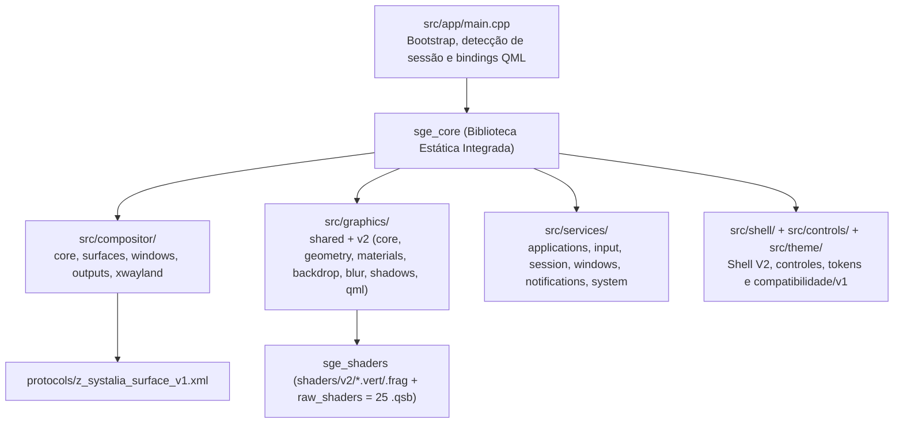

# Systalia Glass Engine — Blueprint Mestre de Engenharia v4.0

**Versão do Blueprint:** 4.0 (alinhado às Etapas 01, 02 e 03.1.1)  
**Data de revisão:** 21 de novembro de 2026  
**Repositório:** `LucasRamosSilva-15/systalia-glass-engine`  
**Branch e commit auditados:** `valo-graphics-2.0` @ `c8e4912`  
**Plano complementar:** [`SGE_IMPLEMENTATION_PLAN.md`](SGE_IMPLEMENTATION_PLAN.md)  
**Pacote de decisões estratégicas:** [`Context/README.md`](Context/README.md)  
**Stack tecnológica observada:** C++23, Qt 6.7+ (ambiente auditado com Qt 6.11.2), Qt Quick / Scene Graph, QtWaylandCompositor, QRhi (Vulkan / OpenGL), GLSL 450 (SPIR-V), CMake, Ninja, CTest, D-Bus, `libudev`/`libinput` (opcionais), XCB/XWayland.

> **Regra de precisão e leitura para agentes e engenheiros:** este Blueprint v4.0 substitui a v3.0 (outubro de 2026), que ainda referenciava o renderer V1 removido, a ABI de 128 bytes e caminhos anteriores à reorganização `06.6B–06.6E`. Nenhuma seção deste documento declara homologação em hardware físico, sessão Fedora independente, benchmarks ou aprovação de usuários sem evidência direta; a distinção entre **aprovado no planejamento**, **implementado no código**, **testado em CTest/aninhado** e **homologado** é estrita.

---

## 1. Identidade, missão, visão e objetivos do SYSTALIA

O **SYSTALIA Desktop Environment (SDE)** é um ambiente desktop Linux experimental implementado pelo **Systalia Glass Engine (SGE)**. O projeto combina um compositor Wayland próprio, uma desktop shell declarativa e o motor óptico **VALO Graphics 2.0** (*Vibrant, Adaptive, Lucid, Organic*).

### 1.1 Missão aprovada (Etapa 02.1, 21/11/2026)

Conforme registrado em [`Context/ETAPA_02_PLANEJAMENTO_ESTRATEGICO_2026.md`](Context/ETAPA_02_PLANEJAMENTO_ESTRATEGICO_2026.md):

> O SYSTALIA é um ambiente desktop Linux experimental, especializado em experiência visual, acessibilidade e produtividade para desenvolvedores e estudantes. Com seu compositor Wayland, shell e linguagem VALO, procura oferecer materiais visualmente expressivos sem sacrificar legibilidade, desempenho, privacidade e previsibilidade. Uma arquitetura modular e o reaproveitamento de serviços Linux sustentam o projeto; decisões documentadas, testes e colaboração orientam sua evolução.

### 1.2 Visão 2030 e posicionamento

- **Visão 2030 (Decisão 25 / Etapa 02.1):** tornar o SYSTALIA um desktop Linux utilizável e reconhecível por sua identidade VALO, sustentado por comunidade e equipe pequena, com contribuições técnicas ao ecossistema Linux, **sem competir com KDE Plasma ou GNOME em quantidade de funcionalidades**.
- **Público-alvo inicial (Decisão 01):** desenvolvedores e estudantes de tecnologia (fluxos de programação, estudo, editor, terminal, navegador, pesquisa e multitarefa), sem excluir outros públicos.
- **Não objetivos:** não criar uma distribuição Linux própria; não reconstruir navegador, terminal completo de produção antes da hora ou stack Linux maduro de áudio/rede; não impor IA como dependência do núcleo da shell.
- **Primeira entrega pública visada (Decisão 06):** **SYSTALIA Alpha 0.1**, uma versão utilizável para desenvolvedores em sessão **Fedora** independente com **Wayland nativo prioritário** e escopo intencionalmente limitado. Data de lançamento e licença permanecem **em aberto**.

### 1.3 Terminologia canônica

| Termo | Significado no projeto |
|---|---|
| **SYSTALIA / SDE** | Produto desktop completo desejado (*Systalia Desktop Environment*). |
| **SGE** | *Systalia Glass Engine*: base de código C++/QML/GLSL que implementa compositor, shell, serviços e motor gráfico. |
| **VALO** | Linguagem visual e princípios **Vibrant, Adaptive, Lucid, Organic**. |
| **VALO Graphics V2** | Renderer óptico único ativo no repositório (`src/graphics/v2/`, `shaders/v2/`). O antigo renderer V1 foi removido na Consolidação 06.6B. |
| **VALO Theme / Controls** | Tokens centralizados (`src/theme/`) e biblioteca/estilo planejado de controles QML coerentes. |
| **SYSTALIA Quick Actions** | Menu discreto de ações úteis com abertura de terminal com comando preparado **sem execução automática** na Alpha (opcional P1). |
| **SYSTALIA AI** | Extensão opcional futura com IA local mediante consentimento explícito; **fora da Alpha 0.1** (intenção de longo prazo `1.1.0`, não promessa de cronograma). |

---

## 2. Decisões aprovadas das Etapas 01 e 02 (`Context/`)

As decisões estratégicas das Etapas 01 (25 escolhas em 17/11/2026) e 02 (02.1–02.7 em 21/11/2026) são vinculantes para o planejamento e não devem ser reabertas por agentes sem pedido explícito do responsável.

### 2.1 Vocabulário de estado e precedência

1. **Aprovado:** política ou escopo escolhido expressamente pelo responsável em `Context/`.
2. **Implementado:** há código versionado no repositório que concretiza a capacidade.
3. **Testado:** há execução automatizada (CTest) ou sessão controlada sob condições documentadas.
4. **Homologado:** os critérios mínimos obrigatórios foram cumpridos em hardware/sessão/usuários reais.
5. **Precedência:** aprovações expressas em [`Context/ETAPA_02_PLANEJAMENTO_ESTRATEGICO_2026.md`](Context/ETAPA_02_PLANEJAMENTO_ESTRATEGICO_2026.md) → dossiê integral [`Context/SYSTALIA_VISION_2027_HANDOFF.md`](Context/SYSTALIA_VISION_2027_HANDOFF.md) → código/contratos atuais no HEAD → relatórios em `docs/`.

### 2.2 Síntese das 25 decisões da Etapa 01 e políticas da Etapa 02

| Eixo | Decisões aprovadas | Referência `Context/` |
|---|---|---|
| **Produto e público** | Desenvolvedores/estudantes (D01); conforto visual e acessibilidade como problema prioritário (D02); perfis de acessibilidade (D03); VALO Glass como diferencial subordinado à legibilidade (D04); Alpha utilizável (D06); workspaces por atividade (D07). | `SYSTALIA_VISION_2027_HANDOFF.md` §2 |
| **Arquitetura e compatibilidade** | Núcleo híbrido/especializado reutilizando serviços Linux (D05, D15); Wayland nativo primeiro e XWayland progressivo (D08); ampla variedade de hardware via perfis adaptativos sem reduzir acessibilidade (D09); núcleo modular integrado `sge_core` com separação orientada por evidências (`02.3-A..E`). | `ETAPA_02_PLANEJAMENTO_ESTRATEGICO_2026.md` §3 |
| **Distribuição, plataforma e hardware** | Pacotes para distribuições existentes e testes reproduzíveis (D11); **Fedora** como distribuição de referência (`02.2-B`, edição exata pendente); categorias **básico e recomendado** (`02.2-C`, limiares pendentes); núcleo obrigatório por toolkit **Qt Quick, Qt Widgets e GTK** (`02.2-D..E`). | `ETAPA_02_PLANEJAMENTO_ESTRATEGICO_2026.md` §2 |
| **Controles e interação** | Consistência VALO em controles QML internos (D16) e evolução progressiva para estilo Qt Quick reutilizável (D17); equilíbrio mouse/teclado (D18); Quick Actions com terminal preparado sem autoexecução na Alpha (D19). | `SYSTALIA_VISION_2027_HANDOFF.md` §2 |
| **Qualidade e privacidade** | Qualidade equilibrada com mínimos obrigatórios em todos os 5 eixos (D14, `02.2-A`, `02.4-B`); modelo híbrido de validação em 3 pilares (`02.4-A`); dados locais por padrão, sem telemetria automática (D20); IA local apenas futura e opcional (D21). | `ETAPA_02_PLANEJAMENTO_ESTRATEGICO_2026.md` §4 |
| **Governança e roadmap** | Modelo híbrido IA + comunidade + equipe pequena (D10); código aberto para aprendizado com **licença ainda a definir** (D12); liderança técnica + ADRs/SDPs (D23); Git como fonte de verdade e Mintlify como portal planejado (D24, `02.6`); grupo pequeno e diverso de testadores (D22); roadmap `Alpha 0.1 → Alpha 0.2 → Beta → 1.0 → pós-1.0` (`02.7`). | `ETAPA_02_PLANEJAMENTO_ESTRATEGICO_2026.md` §§6–7 |

---

## 3. Arquitetura atual e responsabilidades dos subsistemas

Após as Consolidações **06.6B** (remoção definitiva do renderer V1), **06.6C** (modularização de diretórios e CMake), **06.6D** (organização hierárquica por responsabilidade e versão) e **06.6E** (organização de `tests/`, `tools/`, `docs/` e `Dependencies.cmake`), o repositório contém no HEAD `c8e4912`: **88 arquivos** em `src/`, **51** em `tests/`, **22** em `tools/`, **19** em `shaders/v2/` e **76** em `assets/figma/`.

### 3.1 Mapa estrutural de diretórios (estado pós-06.6E)

| Diretório | Responsabilidade | Principais artefatos |
|---|---|---|
| `src/app/` | Ponto de entrada, detecção de plataforma (`SessionBareMetalKms`, `SessionNested`, `SessionHeadless`), registro QML e suspensão de GPU via `logind` | `main.cpp` |
| `src/compositor/core/` | Compositor soberano `SystaliaCompositor`, XDG Shell, SSD, seat, atalhos globais de workspace e task switcher | `SystaliaCompositor.hpp/.cpp` |
| `src/compositor/surfaces/` | Extensão Wayland proprietária `z_systalia_surface_v1` (metadados ópticos por `wl_surface`) | `SystaliaSurfaceExtension.hpp/.cpp` |
| `src/compositor/windows/` | Pilha MRU de janelas e alternador Alt+Tab | `WindowStackModel.hpp/.cpp` |
| `src/compositor/outputs/` | `OutputManagerService`, `QWaylandXdgOutputManagerV1`, escala fracionária e canvas virtual unificado | `OutputManagerService.hpp/.cpp` |
| `src/compositor/xwayland/` | Lançamento sob demanda de `Xwayland`, WM XCB rootless, ponte de clipboard e `XWaylandSurfaceWrapper` | `XWaylandManager.hpp/.cpp` |
| `src/graphics/shared/` | Contratos compartilhados: matriz `std140` (64B) e geometria de recorte de cliente | `ValoStd140Matrix.hpp`, `SystaliaClientClip.hpp` |
| `src/graphics/v2/core/` | UBO `SystaliaSurfacePropsV2` (160B) e contexto adaptativo/acessibilidade `ValoOpticalContext` | `SystaliaSurfacePropsV2.hpp`, `ValoOpticalContext.hpp/.cpp` |
| `src/graphics/v2/geometry/` | Avaliação analítica SDF (`CircularL2`, `SquircleG2`) e transformação orgânica (`slant`) | `ValoGeometryEngineV2.hpp/.cpp`, `ValoOrganicTransform.hpp/.cpp` |
| `src/graphics/v2/materials/` | Nó QSG, upload UBO 160B, idle-freeze de cáusticas e vinculação de shaders V2 | `ValoGlassItemV2.hpp/.cpp`, `ValoGlassMaterialV2.hpp/.cpp` |
| `src/graphics/v2/backdrop/` | Provedor de textura de fundo com proteção contra feedback recursivo e fallback sintético | `ValoBackdropProviderV2.hpp/.cpp` |
| `src/graphics/v2/blur/` | Pipeline Dual-Kawase GPU multipass no `beforeRendering` com dirty tracking | `ValoBlurPipelineV2.hpp/.cpp`, `ValoGpuBlurPipelineV2.hpp/.cpp` |
| `src/graphics/v2/shadows/` | Sombra analítica externa contínua (`valo_shadow_v2`) | `ValoShadowItemV2.hpp/.cpp` |
| `src/graphics/v2/qml/` | Superfície unificada `ValoMaterialSurfaceV2.qml`, partículas, backdrops e Dock V2 | 9 arquivos `Valo*V2.qml` |
| `src/shell/` | `core/` (`main.qml`, `WorkspaceViewport.qml`, `WaylandClientView.qml`, `WaylandWindowContainer.qml`), `dock/`, `topbar/`, `windows/`, `overlays/`, `panels/` e `compatibility/v1/` | 18 arquivos `.qml` |
| `src/controls/` | Controles reutilizáveis extraídos: `frames/` (`SystaliaG2Frame.qml`), `windows/` (`SystaliaWindowAction.qml`, `SystaliaWindowHeader.qml`), `dock/` (`ValoDockItem.qml`) | 4 arquivos `.qml` |
| `src/services/` | Serviços Linux e de sessão: `applications/`, `input/`, `session/`, `windows/`, `notifications/`, `system/` | 18 arquivos `.hpp/.cpp` |
| `src/theme/` | `tokens/` (`ValoTokens.hpp`, `valo.tokens.json`), `qml/` (`ValoTheme.qml`) e `compatibility/v1/` (`SystaliaTheme.qml`) | 4 arquivos |
| `src/diagnostics/` | Sondas de estabilidade, alinhamento de cabeçalho e resize interno | `ValoStabilityProbe.hpp`, `ValoHeaderAlignmentProbe.hpp`, `ValoInternalResizeProbe.hpp` |
| `cmake/` | Build modularizado preservando alvos existentes | `Dependencies.cmake`, `SgeShaders.cmake`, `SgeCore.cmake`, `SgeQml.cmake`, `SgeInstall.cmake`, `SgeTools.cmake` |
| `protocols/`, `shaders/v2/`, `assets/figma/` | Especificação XML Wayland, 19 shaders GLSL V2 e 76 assets SVG/PNG exportados do Figma | — |
| `tests/`, `tools/` | 48 alvos CTest (`unit/`, `integration/`, `e2e/`, `graphics/`, `compositor/`, `protocol-client/`) e ferramentas (`benchmarks/`, `artifacts/`, `diagnostics/`, `maintenance/`) | 51 + 22 arquivos |

### 3.2 Fronteiras lógicas e estado real do núcleo (`02.3-A..E`)

- **Núcleo integrado (`sge_core`):** conforme aprovado na Etapa `02.3-A/B`, compositor, serviços, VALO Graphics V2 e módulo QML permanecem ligados na biblioteca estática `sge_core`, sem separação prematura em processos isolados.
- **Acoplamentos observados na auditoria:** `SystaliaCompositor` mantém ponteiros diretos para `WindowStackModel`, `WorkspaceManagerService`, `OutputManagerService`, `SystaliaSurfaceExtension` e `XWaylandManager`. `src/app/main.cpp` instancia os serviços de sistema no stack e os expõe como singletons QML em `Systalia.System 1.0`. O isolamento entre domínios é lógico/organizacional e orientado por sinais, não por processos separados.

---

## 4. Contratos C++/QML, Wayland, GPU, ABI, recursos QRC e compatibilidade

### 4.1 Classificação de maturidade dos contratos (`02.3-D`)

| Classe | Contratos abrangidos | Regra de evolução |
|---|---|---|
| **Protegido** | `protocols/z_systalia_surface_v1.xml`, `SystaliaSurfacePropsV2` (160B), `Matrix4x4_std140` (64B), ciclo de vida de buffers Wayland (`ShellSurfaceItem`), regras `LogindSessionService` | Exige análise de compatibilidade, testes de ABI/protocolo, ADR e aprovação humana. |
| **Estável** | URI QML `Systalia.Engine 1.0`, `Systalia.Compositor 1.0`, `Systalia.System 1.0`, aliases QRC sob `qrc:/qt/qml/Systalia/Engine/src/qml/...`, adaptadores `src/shell/compatibility/v1/` e `src/theme/compatibility/v1/` | Preservar compatibilidade ou fornecer camada de migração e depreciação explícita. |
| **Experimental** | `XWaylandManager`, heurísticas de `backdropSelection` em clientes externos, parâmetros visuais internos de `ValoOpticalParticlesV2`, protótipos de probes em `src/diagnostics/` | Podem evoluir com registros e testes proporcionais ao risco. |

### 4.2 Contrato de memória GPU V2 (`SystaliaSurfacePropsV2` — 160 bytes)

A antiga struct V1 (`SystaliaSurfaceProps`, 128 bytes) foi removida na Consolidação 06.6B. O único contrato UBO ativo do motor óptico é `Systalia::Gfx::V2::SystaliaSurfacePropsV2` em [`src/graphics/v2/core/SystaliaSurfacePropsV2.hpp`](src/graphics/v2/core/SystaliaSurfacePropsV2.hpp), protegido em tempo de compilação por `static_assert` (`sizeof == 160`, `alignof == 16`) e validado por `tst_memory_alignment` e `tst_surface_props_alignment_v2`:

| Campo | Offset | Tamanho | Tipo / Semântica |
|---|---:|---:|---|
| `matrix` | 0 | 64 B | `Matrix4x4_std140` (matriz MVP normalizada, definida em `src/graphics/shared/ValoStd140Matrix.hpp`) |
| `radii` | 64 | 16 B | `QVector4D` — raios TL, TR, BL, BR em pixels lógicos |
| `windowSize` | 80 | 8 B | `QVector2D` — largura e altura lógicas |
| `screenResolution` | 88 | 8 B | `QVector2D` — viewport físico (sinal de Y no upload indica framebuffer Y-up) |
| `slant` | 96 | 4 B | `float` — inclinação visual 3D em radianos |
| `ior` | 100 | 4 B | `float` — índice de refração (default `1.25f`) |
| `chromaticDispersion` | 104 | 4 B | `float` — dispersão cromática de Cauchy (default `0.040f`) |
| `causticIntensity` | 108 | 4 B | `float` — intensidade das cáusticas (default `0.85f`) |
| `surfaceOpacity` | 112 | 4 B | `float` — opacidade base da superfície (default `0.34f`) |
| `time` | 116 | 4 B | `float` — tempo acumulado de animação em segundos |
| `hasClientTexture` | 120 | 4 B | `float` — flag `0.0f` ou `1.0f` |
| `titleBarHeight` | 124 | 4 B | `float` — altura de barra de título / opacidade herdada no upload V2 (`36.0f`) |
| `specularStrokeWidth` | 128 | 4 B | `float` — espessura da borda especular em px (`1.25f`) |
| `geometryMode` | 132 | 4 B | `float` — `0.0f` (`CircularL2`) ou `1.0f` (`SquircleG2`) |
| `shadowIntensity` | 136 | 4 B | `float` — opacidade da sombra externa (`0.35f`) |
| `shadowOffsetY` | 140 | 4 B | `float` — deslocamento vertical da sombra (`12.0f`) |
| `volumetricTint` | 144 | 16 B | `QVector4D` — tonalização volumétrica RGBA (`{0.03f, 0.18f, 0.32f, 0.39f}`) |

*Nota de contrato:* `ValoGlassItemV2::particleIntensity` é usada exclusivamente para agendamento do overlay `ValoOpticalParticlesV2` e **nunca** deve ser anexada ao UBO de 160 bytes.

### 4.3 Protocolo Wayland proprietário (`z_systalia_surface_v1.xml`)

- **Distinção obrigatória:** o sufixo `_v1` em `z_systalia_surface_v1` refere-se à **versão do protocolo Wayland** (ativo e protegido), não tendo relação com o antigo renderer óptico V1 removido.
- **Interfaces:** `z_systalia_manager_v1` (factory por `wl_surface`) e `z_systalia_surface_v1` (parâmetros `set_corner_radii`, `set_slant`, `set_optical_properties` em fixed-point 24.8 com validação de intervalo e destruição segura se a superfície morrer).
- **Geração:** `qt6_generate_wayland_protocol_server_sources(sge_core ...)` em `cmake/SgeCore.cmake`.

### 4.4 Módulos QML e preservação de aliases QRC

- **Módulos registrados:**
  - `Systalia.Engine 1.0` (`cmake/SgeQml.cmake`, `NO_PLUGIN`, prefixo `/qt/qml`, tipos `QML_ELEMENT` de `src/graphics/v2/` e `SystaliaSurfaceExtension`).
  - `Systalia.Compositor 1.0` (`SystaliaCompositor` registrado em `src/app/main.cpp`).
  - `Systalia.System 1.0` (singletons C++: `SystemTelemetry`, `ProcessLauncher`, `AppRegistry`, `Notifications`, `SystemControl`, `WorkspaceManager`, `LiquidTiling`, `OutputManager`, `LogindSession`, `InputDeviceManager`).
- **Aliases QRC preservados:** `cmake/SgeQml.cmake` aplica `QT_RESOURCE_ALIAS` em todos os arquivos QML e assets `assets/figma/*` para manter intactas as URLs `qrc:/qt/qml/Systalia/Engine/src/qml/...` e os imports relativos internos após a reorganização 06.6C/06.6D.

---

## 5. Arquitetura VALO Graphics V2

O **VALO Graphics 2.0** substituiu o modelo multi-camada legado por um **Pipeline de Superfície Única**, no qual contorno, máscara SDF, refração, preenchimento volumétrico e borda especular compartilham uma única definição geométrica no Scene Graph.

### 5.1 Pipeline de renderização e materiais

- **`ValoGlassItemV2` (`QQuickItem`):** ancora `ValoGlassMaterialV2` em `QSGGeometryNode`, gerencia política de animação com congelamento de ociosidade (*idle-freeze* via `QTimer`/`QElapsedTimer` e `onIdleTimeout`), pausa quando a janela não está visível e fornece textura de fallback em ambientes sem RHI ativo.
- **`ValoGlassMaterialV2` / `ValoGlassMaterialShaderV2`:** gerencia o upload do UBO de 160 bytes em `updateUniformData`, vincula texturas de backdrop filtrado e cliente em `updateSampledImage`, e compartilha o mesmo `QSGMaterialType` por `diagnosticMode` (0 = composição final `H`; 1–9 = passes diagnósticos isolados `A`..`K`).
- **`ValoShadowItemV2`:** renderiza sombra externa contínua via `valo_shadow_v2.vert/.frag` alinhada ao mesmo `geometryMode` (`CircularL2` / `SquircleG2`) e `cornerRadii`.
- **`ValoMaterialSurfaceV2.qml`:** componente QML composto que integra `ValoShadowItemV2` (`z: 0`), `ValoGlassItemV2` (`z: 5`), `ValoOpticalParticlesV2` (`z: 6`, desligado quando `blurProfile === 0`) e `contentContainer` (`z: 10`), conectado a `ValoBackdropProviderV2` e `ValoOpticalContext`.

### 5.2 Geometria analítica SDF e transformação orgânica

- **`ValoGeometryEngineV2`:** implementa duas famílias analíticas compartilhadas com os shaders:
  - `CircularL2` (`geometryMode == 0`): cantos circulares euclidianos para cápsulas (`SystaliaTopBarV2`, `SystaliaDockV2`).
  - `SquircleG2` (`geometryMode == 1`): superelipse de quarta ordem ($L_4$) com continuidade de curvatura $C^2$ para janelas e painéis.
- **`ValoOrganicTransform`:** aplica inclinação 3D (`slant`) mantendo o recorte e a borda especular coerentes, com proteção algébrica contra singularidades (`NaN`).
- **Antialiasing:** `valo_optical_v2.frag` utiliza `max(fwidth(dist), 0.75)` e `smoothstep`, descartando fragmentos estritamente fora da franja (`if (coverage <= 0.0001) discard;`) e compondo em alpha pré-multiplicado.

### 5.3 Backdrop, Dual-Kawase GPU e estratégia para clientes externos

- **`ValoBackdropProviderV2` e `ValoGpuBlurPipelineV2`:** capturam a cena upstream (protegendo contra feedback recursivo via `setConsumerItem`), executam a pirâmide Dual-Kawase (`valo_kawase_down`, `valo_kawase_up`, `valo_backdrop_copy`) no gancho `beforeRendering` e rastreiam sujeira (`isDirty`) para saltar passes quando a cena está em repouso.
- **Restrição preservada para clientes Wayland/XWayland:** conforme observado em `WaylandWindowContainer.qml`, **clientes externos utilizam deliberadamente o backdrop apenas do wallpaper** (`backdropSelectionMode: "wallpaper-only"` / `"wallpaper-only-uncertified"`). A captura de superfícies de clientes externos (`ShellSurfaceItem`) ou compartilhamento de buffers entre passes auxiliares permanece proibida sem contrato explícito de sincronização/ciclo de vida.
- **Shaders empacotados (`cmake/SgeShaders.cmake`):** **19 shaders** em `shaders/v2/` + **6 shaders** em `tools/diagnostics/raw_render_diagnostics/shaders/` = **25 arquivos `.qsb`** SPIR-V compilados pelo `Qt6::ShaderTools`.

---

## 6. Shell, Controles e Compatibilidade QML

### 6.1 Componentes ativos da Shell (`src/shell/`)

| Área | Arquivos principais | Responsabilidade real observada |
|---|---|---|
| **Core** | `main.qml`, `WorkspaceViewport.qml`, `WaylandClientView.qml`, `WaylandWindowContainer.qml` | Canvas de referência 1662 × 975 (escalável), wallpaper `valo-ocean-atmosphere.png`, viewport multi-workspace, moldura única `ValoMaterialSurfaceV2` (`clientDecorationV2`) para clientes Wayland e XWayland. |
| **TopBar** | `src/shell/topbar/SystaliaTopBarV2.qml` | Cápsula `CircularL2` com marca SYSTALIA, badge `SDE-KWIN \| VALO`, telemetria CPU/RAM/FPS, relógio, indicador de workspaces e 6 glifos de ação. |
| **Dock** | `src/shell/dock/SystaliaDockV2.qml` + `src/graphics/v2/qml/ValoDockV2*.qml` | Cápsula `CircularL2` (555 × 125, raio 47) com 5 lançadores SVG e indicadores de execução/foco integrados ao compositor. |
| **Janelas internas e painéis** | `SystaliaFilesWindowV2.qml`, `SystaliaMaterialWindow.qml`, `SystaliaControlCenterV2.qml` | *Systalia Files* (janela demonstrativa com navegação simulada e assets SVG), *Material Window* (controles em tempo real de IOR, opacidade, dispersão, cáusticas, raio e slant) e *Control Center* (controles de sistema). |
| **Overlays** | `SystaliaFlowMenu.qml`, `SystaliaNotificationHost.qml`, `SystaliaTaskSwitcher.qml`, `SnapPreviewOverlay.qml`, `TileSplitter.qml` | Lançador de apps filtrável, toasts D-Bus, alternador MRU Alt+Tab, prévia de snap magnético e divisor dinâmico de Liquid Tiling. |

### 6.2 Controles reutilizáveis (`src/controls/`) e lacuna de *VALO Controls*

- Atualmente `src/controls/` reúne 4 primitivas compartilhadas de moldura e dock (`SystaliaG2Frame.qml`, `SystaliaWindowAction.qml`, `SystaliaWindowHeader.qml`, `ValoDockItem.qml`).
- **Lacuna conhecida (Decisões 16 e 17):** ainda **não existe** uma biblioteca completa de controles Qt Quick `VALO Controls` (botões, campos de texto, sliders, checkboxes, menus, diálogos padronizados com estados completos de foco/teclado/disabled). A criação e padronização desses controles para os fluxos da shell é requisito da Alpha 0.1 (`RF-08`).

### 6.3 Adaptadores de compatibilidade V1 (`compatibility/v1/`)

- `src/shell/compatibility/v1/` (`SystaliaTopBar.qml`, `SystaliaDock.qml`, `SystaliaFilesWindow.qml`, `SystaliaControlCenter.qml`) e `src/theme/compatibility/v1/SystaliaTheme.qml` preservam nomes públicos QML antigos encaminhando para implementações V2.
- `WaylandWindowContainer.qml` e `main.qml` expõem `readonly property bool useGraphicsV2: true` apenas para leitura em sondas/testes; **não há fallback para renderer V1**.

---

## 7. Compositor: superfícies, buffers, foco, input, outputs, XDG e XWayland

### 7.1 Wayland Core, XDG Shell e Decoradores

- **`SystaliaCompositor` (`src/compositor/core/SystaliaCompositor.hpp/.cpp`):** inicializa `QWaylandCompositor` (socket `wayland-systalia-0`), `QWaylandXdgShell`, `QWaylandXdgDecorationManagerV1` (impondo SSD), `QWaylandViewporter` e `SystaliaSurfaceExtension` (`z_systalia_surface_v1`).
- **Apresentação de buffers:** `WaylandWindowContainer.qml` hospeda `ShellSurfaceItem` diretamente dentro do viewport recortado (`clip: true`), sem `hideSource: true`, preservando o conteúdo original de cada aplicação cliente.
- **Ciclo de vida e resize:** suporta minimizar, maximizar/restaurar com geometria salva, fechar, arraste pelas 8 bordas/cantos e throttling V-Blank de eventos `configure` via `LiquidTilingService`.

### 7.2 Foco, Workspaces e Liquid Tiling

- **`WindowStackModel`:** mantém ordem MRU das janelas para elevação e `Alt+Tab` / `Alt+Shift+Tab`.
- **`WorkspaceManagerService`:** gerencia 4 workspaces por padrão, troca por atalhos (`Super+Ctrl+Left/Right`, `Super+1..4`, `Super+Shift+1..4`), cálculo de frustum e culling de visibilidade de janelas fora da área ativa.
- **`LiquidTilingService`:** detecta zonas de snap magnético (bordas e cantos), calcula raios $G^2$ fundidos (`calculateFusedRadii`), gerencia `splitRatio` (`0.20` a `0.80`) e protege a distância SDF contra `NaN`.

### 7.3 Outputs, Escalonamento Fracionário e Input

- **`OutputManagerService`:** integra `QWaylandXdgOutputManagerV1` / `QWaylandXdgOutputV1`, calcula `virtualCanvasBounds()`, roteia janelas por centro geométrico entre telas e converte escala fracionária em 120ths para o protocolo Wayland.
- **Entrada (`InputDeviceManager` + `QWaylandSeat`):** roteia eventos de teclado diretamente via `QWaylandSeat::sendFullKeyEvent` quando necessário e implementa integração opcional com `libudev`/`libinput` (eventos de teclado, ponteiro, botões e gestos de swipe de 3 dedos para troca de workspace).

### 7.4 XWayland (`XWaylandManager` — experimental/progressivo)

- `XWaylandManager` gerencia processo `Xwayland` sob demanda (`-rootless`, `-listenfd`, `-wm`, `-displayfd`), conexão XCB rootless (átomos `WM_NAME`, `_NET_WM_NAME`, `WM_CLASS`, `_NET_WM_STATE`, `WL_SURFACE_ID`), ponte bidirecional de clipboard Wayland ↔ X11 e `XWaylandSurfaceWrapper` compatível com `WaylandWindowContainer.qml`.
- **Estado e limites reais:** `tst_xwayland_integration` passa no CTest; na Consolidação 06.5 clientes X11 modernos (`gtk3-demo`, `kdialog`, `alacritty` X11) exibiram conteúdo em `decorationV2`, porém clientes Xt/Xaw legados (`xmessage`) apresentaram conteúdo em branco (`#FFFFFF`) tanto na V1 quanto na V2 (defeito independente do renderer óptico, atribuído ao tratamento de sub-janelas/Expose em Xwayland rootless). Na Alpha 0.1, XWayland **não é compromisso universal** (`RF-12` é P1 posterior).

---

## 8. Serviços Linux, processos, sessão, logind, D-Bus e integração Fedora

| Serviço (`src/services/`) | Mecanismo Linux / IPC | Estado e riscos observados |
|---|---|---|
| `InputDeviceManager` | `evalPlatformEnvironment` + `config/eglfs_kms.json` + `libudev`/`libinput` | Detecta automaticamente `SessionBareMetalKms`, `SessionNested` ou `SessionHeadless`. **Risco:** caminho relativo `"config/eglfs_kms.json"` passado em `src/app/main.cpp` precisa ser validado em sessão instalada no sistema. |
| `LogindSessionService` | D-Bus `org.freedesktop.login1.Manager` e `.Session` (`TakeControl`, `TakeDevice`, `PauseDevice`/`ResumeDevice`) | Em `SessionBareMetalKms`, `main.cpp` tenta adquirir controle da sessão e DRM primário (`/dev/dri/card0`), conectando `gpuSubmissionSuspendedChanged` para ocultar janela e liberar recursos RHI na troca de VT. Testado com mock D-Bus (`tst_logind_integration`), **não homologado em VT/TTY Fedora real**. |
| `NotificationServer` | D-Bus `org.freedesktop.Notifications` | Exporta interface padrão com expiração e ações. Se outro daemon possuir o nome no barramento da sessão hospedeira, o conflito é reportado sem substituição forçada. |
| `SystemTelemetryService` | Leitura de `/proc/stat` e `/proc/meminfo` | Publica CPU, RAM, hora e FPS para a TopBar sem envio externo. |
| `ProcessLauncherService` & `AppRegistryService` | `QProcess` com `WAYLAND_DISPLAY` dedicado + varredura XDG `.desktop` | Lança aplicativos com ambiente Wayland e indexa ícones via `DesktopIconProvider`. |
| `SystemControlService` | Utilitários de sistema (volume/brilho) | Mantém estado de toggles e ajustes rápidos do Control Center. |

**Artefatos de sessão (`data/` e `cmake/SgeInstall.cmake`):**
- `cmake/SgeInstall.cmake` instala `systalia_glass_engine` em `${CMAKE_INSTALL_BINDIR}`, `data/systalia-session` em `${CMAKE_INSTALL_BINDIR}` e `data/systalia.desktop` em `${CMAKE_INSTALL_DATADIR}/wayland-sessions`.
- **Risco de empacotamento identificado na auditoria 03.1:** `data/systalia-session` invoca `/usr/bin/systalia_glass_engine` fixo e `data/systalia.desktop` invoca `/usr/bin/systalia-session` fixo. Instalações fora de `/usr` (ex.: `/usr/local`) exigem ajuste ou empacotamento RPM específico para Fedora em `/usr`.

---

## 9. Estratégia de acessibilidade e perfis gráficos

### 9.1 Infraestrutura implementada (`ValoOpticalContext` + `ValoMaterialSurfaceV2`)

- `ValoOpticalContext` expõe propriedades e invariantes para `ambientLuminance` (`[0.0, 1.0]`), `adaptiveOpacityOffset` (`[-0.20, 0.35]`), `prefersReducedMotion`, `highContrastEnabled` e `energySavingFactor`.
- `ValoMaterialSurfaceV2.qml` e `WaylandWindowContainer.qml` propagam `userHighContrast` e `userPrefersReducedMotion`, aumentando opacidade e removendo sombras/transparências excessivas em alto contraste.
- Perfis gráficos `blurProfile`: `0 = Performance` (desativa partículas e reduz efeitos), `1 = Balanced`, `2 = Quality` (IOR `1.25`, dispersão `0.040`, cáusticas `0.18`).

### 9.2 Lacunas para cumprir a Alpha 0.1 (`RF-06`, `RNF-02`, Decisões 02 e 03)

- Ainda faltam **perfis nomeados e persistentes de acessibilidade** acessíveis na UI (ex.: *Alta Legibilidade*, *Movimento Reduzido*, *Leitura/Concentração*) ligados a preferências locais.
- Falta auditoria e garantia completa de **navegação 100% por teclado** (*keyboard-only*), **indicadores visíveis de foco**, **escala tipográfica/UI** e **testes com pessoas reais** com necessidades diversas.
- **Regra inegociável:** nenhuma otimização de desempenho no perfil `Performance` pode reduzir legibilidade, foco ou contraste definidos pelo perfil de acessibilidade.

---

## 10. Modelo de qualidade, testes e homologação

### 10.1 Modelo híbrido de três pilares (`02.4-A`)

1. **Testes automatizados (CTest):** regressão unitária, ABI, shaders, protocolo Wayland, integração de modelos e ciclo de vida E2E.
2. **Avaliações manuais em sessões reais:** execução em sessão Fedora independente com drivers/GPU reais, aplicativos nativos por toolkit, áudio/rede/login/VT e diagnósticos de longa duração.
3. **Testes com usuários reais (Decisão 22):** grupo pequeno e diverso (desenvolvedores, estudantes e pessoas com diferentes necessidades de acessibilidade) avaliando tarefas reais.

### 10.2 Suíte automatizada atual (48 alvos CTest em `tests/CMakeLists.txt`)

| Camada / Diretório | Quantidade de alvos CTest | Escopo principal |
|---|---:|---|
| `tests/graphics/` | 6 | `tst_systalia_engine` (UBO 160B + `.qsb`), `tst_item_geometry`, `tst_sdf_geometry`, `tst_backdrop_binding`, `tst_optical_physics`, `tst_unified_composition` |
| `tests/compositor/` | 5 | `tst_wayland_socket`, `tst_xdg_shell`, `tst_xdg_decorations`, `tst_xdg_resize`, `tst_systalia_protocol` |
| `tests/unit/` | 31 | Alinhamento (`tst_memory_alignment`, `tst_surface_props_alignment_v2`), matemática SDF V1/V2, parsers Linux, serviços, `tst_input_hardware_backend`, `tst_logind_integration`, `tst_xwayland_integration`, `tst_resource_leak_audit`, `tst_phase4_audit`, suíte V2 (`tst_valo_*_v2`), `tst_evidence_cleanup` (Python, 10 casos) |
| `tests/integration/` | 5 | `tst_protocol_roundtrip`, `tst_xdg_shell_decoration`, `tst_app_model_filtering`, `tst_shell_state_regression`, `tst_client_surface_visibility` |
| `tests/e2e/` | 1 | `tst_wayland_client_lifecycle_e2e` |

**Nota metodológica:** a Consolidação `06.6E` (`5bb4112`) registrou **48/48 CTest aprovados** em Debug e Release com `-Werror` sob `QT_QPA_PLATFORM=offscreen` e execução de `alacritty` em compositor aninhado. Esta etapa 03.1.1 é puramente documental e não reexecutou builds ou benchmarks.

### 10.3 Governança de evidências de diagnóstico (`AGENTS.md` / `GEMINI.md`)

Ferramentas em `tools/maintenance/` (`sge_evidence.py` e `sge_artifact_dir.hpp`) geram diretórios exclusivos em `${TMPDIR:-/tmp}/systalia-runs/<tool>-<id>/` com lock `flock` (`.sge-run.lock`) e metadados `run-status.json` (`managed_by: "sge-evidence-v1"`), removendo evidências automaticamente em sucesso e retendo falhas por 24 horas sem poluir `docs/` ou `artifacts/` rastreados.

---

## 11. Requisitos obrigatórios, opcionais e futuros da Alpha 0.1

Conforme aprovado em [`Context/ETAPA_02_PLANEJAMENTO_ESTRATEGICO_2026.md`](Context/ETAPA_02_PLANEJAMENTO_ESTRATEGICO_2026.md) (§§2 e 5):

### 11.1 Requisitos funcionais (RF) e não funcionais (RNF)

- **Obrigatórios na Alpha 0.1 (P0):**
  - `RF-01`: Instalar e executar sessão Fedora independente.
  - `RF-02`: Abrir, mover, redimensionar e fechar janelas Wayland.
  - `RF-03`: Foco, empilhamento, maximização e restauração.
  - `RF-04`: Workspaces organizados por atividade (mínimo: nomeação, organização por área, troca e movimentação de janelas).
  - `RF-05`: Dock e TopBar funcionais.
  - `RF-06`: Perfis básicos de acessibilidade e ajustes individuais preservados.
  - `RF-07`: VALO Glass adaptativo com degradação segura de efeitos.
  - `RF-08`: Controles internos VALO coerentes e acessíveis.
  - `RF-09`: Uso essencial completo por teclado e mouse.
  - `RF-11`: Núcleo de aplicativos selecionados por toolkit (**Qt Quick Qt 6**, **Qt Widgets Qt 6**, **GTK 3/4**) funcionando sob Wayland nativo (com política `02.2-E`: núcleo obrigatório passa, limitações não críticas documentadas).
  - `RNF-01..RNF-07`: Estabilidade (sem falhas críticas nos fluxos homologados), Acessibilidade, Desempenho medido nas categorias **básico e recomendado**, Consistência VALO, Privacidade local sem telemetria automática, Compatibilidade no núcleo por toolkit e Reprodutibilidade de build/instalação/testes.
- **Opcional na Alpha 0.1 (P1):**
  - `RF-10`: Quick Actions abrindo terminal homologado com comando preparado **sem execução automática**.
- **Posteriores / fora da Alpha 0.1:**
  - `RF-12` (P1): Expansão da compatibilidade XWayland.
  - `RF-13` (P1): Biblioteca pública de estilo VALO Qt Quick reutilizável (evolução progressiva).
  - `RF-14` (P2): Extensão opcional de IA local (objetivo distante `1.1.0`, sem promessa de entrega).
  - **Também fora da Alpha 0.1:** tema universal para GTK/Qt Widgets externos, plataforma pública de plugins, restauração automática avançada de sessão de aplicativos e suporte garantido a qualquer GPU/monitor/distribuição.

---

## 12. Matriz de implementação versus homologação

| Capacidade / Área | Código implementado | Evidência de teste atual | Estado de homologação |
|---|---|---|---|
| **Motor óptico VALO V2 (UBO 160B, SDF L2/G2, Dual-Kawase, sombras)** | Sim (`src/graphics/v2/`, `shaders/v2/`) | CTest unitário/contrato + capturas aninhadas (`06.6E`) | **Não homologado** em GPU/hardware de referência e benchmarks finais |
| **Compositor Wayland XDG + SSD + resize + protocolo `z_systalia_surface_v1`** | Sim (`src/compositor/`) | CTest `tst_xdg_*`, `tst_systalia_protocol`, `tst_wayland_client_lifecycle_e2e` + Alacritty aninhado | **Não homologado** com matriz Qt Quick/Qt Widgets/GTK em sessão real |
| **Workspaces por atividade e Liquid Tiling** | Sim (`src/services/windows/`, `WorkspaceViewport.qml`) | `tst_workspace_manager`, `tst_liquid_tiling`, `tst_shell_state_regression` | **Parcial** (faltam fluxos de nomeação/organização por atividade na UI e uso prolongado) |
| **Sessão independente Fedora (DRM/KMS, logind, libinput, scripts)** | Sim (infraestrutura em `src/app/`, `src/services/{input,session}/`, `data/`) | `tst_input_hardware_backend`, `tst_logind_integration` (mocks/unitários) | **Não homologado** — falta execução bare-metal/VM real no Fedora alvo |
| **Outputs múltiplos e escala fracionária** | Sim (`OutputManagerService`) | `tst_output_manager` | **Não homologado** em múltiplos monitores físicos |
| **Acessibilidade (perfis, alto contraste, reduced motion, keyboard-only)** | Parcial (`ValoOpticalContext`, flags `userHighContrast` / `userPrefersReducedMotion`) | Verificação básica em `tst_valo_*` | **Não homologado** — faltam perfis completos, navegação integral por teclado e avaliação humana |
| **VALO Controls internos consistentes** | Parcial (`src/controls/` tem 4 primitivas) | `tst_valo_decorations`, `tst_valo_shell_v2` | **Incompleto / Não homologado** — faltam controles padronizados completos na shell |
| **XWayland bridge** | Sim (`XWaylandManager`, experimental) | `tst_xwayland_integration` + testes `06.5` (modernos ok, `xmessage` em branco) | **Experimental / Não obrigatório na Alpha 0.1** |
| **Quick Actions, IA local, Mintlify publicado, licença** | Não / Pendente | N/A | **Pendente** (`IA` e `Mintlify` fora de código; licença não escolhida) |

---

## 13. Riscos técnicos, limitações e dívidas arquiteturais

1. **Sessão autônoma não comprovada em hardware real:** `InputDeviceManager`, `LogindSessionService` e `data/systalia-session` existem no código, mas ainda não foram validados em login SDDM/TTY no Fedora alvo (incluindo troca de VT, `PauseDevice`/`ResumeDevice` e caminhos `/usr/bin` / `config/eglfs_kms.json`).
2. **Apresentação de buffers externos e `backdropSelection`:** clientes externos usam fallback apenas do wallpaper; captura segura de janelas clientes subjacentes e comportamento com clientes acelerados em diversos drivers Mesa/Vulkan/DRM permanecem em aberto para a Etapa 03.3/03.5.
3. **Lacunas de acessibilidade e controles:** ausência de perfis de acessibilidade configuráveis de ponta a ponta e de biblioteca completa de controles acessíveis por teclado pode bloquear o gate da Alpha (`02.4-B`).
4. **Dívida de UI demonstrativa:** *Systalia Files* (`SystaliaFilesWindowV2.qml`) ainda é janela demonstrativa com itens estáticos, e o tamanho base `1662 × 975` precisa de validação responsiva em resoluções menores e maiores.
5. **XWayland e toolkits legados:** clientes Xt/Xaw legados falham na exibição sob Xwayland rootless; não prometer suporte amplo na Alpha.
6. **Licença e governança externa:** repositório sem licença definitiva escolhida (Decisão 12) impede redistribuição formal e aceitação ampla de contribuições; site Mintlify ainda não verificado/publicado.

---

## 14. Governança, documentação, ADRs, SDPs e IA

- **Fonte de verdade:** Git (`LucasRamosSilva-15/systalia-glass-engine`) é a fonte de verdade para código, contratos, testes e documentação (`docs/README.md`). Mintlify é o portal central planejado, ainda não considerado implantado.
- **ADRs ativos (`docs/architecture/adr/`):**
  - `0001-valo-v2-como-renderer-oficial.md` — concluída na `06.6B` (V2 como renderer único).
  - `0002-limites-de-modulos-e-recursos.md` — concluída nas `06.6C–06.6E` (árvore hierárquica, CMake modular, `QT_RESOURCE_ALIAS`).
  - `0003-aposentadoria-decoration-v1.md` — concluída na `06.5` (`ValoMaterialSurfaceV2` como decoração única).
- **SDPs e desenvolvimento com IA (Decisões 10, 23, 24):** agentes de IA aceleram código, testes e documentação, mas **não aprovam decisões estratégicas nem declaram homologação**. Mudanças materialmente relevantes exigem motivação, impacto em contratos/acessibilidade/desempenho, testes proporcionais, atualização documental e revisão humana.
- **Privacidade:** dados de uso, preferências e logs de diagnóstico permanecem locais por padrão; nenhuma telemetria é enviada automaticamente.

---

## 15. Roadmap `Alpha 0.1 → Alpha 0.2 → Beta → 1.0 → pós-1.0`

Sem datas ou compromissos de calendário fixos; a progressão é controlada por critérios de qualidade (*quality-gated*):

1. **Planejamento Técnico Atual (Etapa 03: `03.1`–`03.7`):** auditoria (`03.1`/`03.1.1`), sessão Fedora independente (`03.2`), compositor/workspaces (`03.3`), shell/VALO V2/acessibilidade (`03.4`), matriz Qt Quick/Qt Widgets/GTK (`03.5`), benchmarks básico/recomendado (`03.6`), testes com usuários e decisão de release (`03.7`).
2. **Alpha 0.1:** desktop utilizável para desenvolvedores no Fedora, Wayland nativo prioritário, perfis básicos de acessibilidade, workspaces e núcleo por toolkit homologado, com problemas conhecidos documentados e licença definida.
3. **Alpha 0.2:** correções de estabilidade e UX baseadas no feedback da 0.1, ampliação de compatibilidade, avanços em XWayland e hardware adicional.
4. **Beta:** consolidação de estabilidade, acessibilidade validada com usuários mais amplos, serviços de sessão e documentação completa.
5. **1.0:** primeira versão estável após cumprimento integral dos cinco eixos de qualidade em hardware e cenários definidos.
6. **Pós-1.0:** ecossistema opcional de extensões, melhorias de produtividade e pesquisa/implementação da extensão opcional de IA local com consentimento explícito (intenção `1.1.0`, não garantia de prazo).

---

## 16. Evolução prevista para o Blueprint v5.0

Este Blueprint v4.0 consolida a arquitetura pós-reorganização (`06.6E`) e as decisões estratégicas aprovadas (`Etapas 01–02`). **A versão 5.0 do Blueprint não deve ser produzida agora**; ela só será justificada quando as entregas técnicas da Etapa 03 produzirem fatos novos verificáveis que alterem o estado de engenharia do projeto, especificamente:

1. **Homologação da sessão Fedora independente (`03.2`):** definição oficial da edição/versão Fedora, empacotamento RPM/prefixo, validação real de DRM/KMS, `logind`, `libinput` e recuperação de sessão/VT.
2. **Fechamento da matriz de compatibilidade por toolkit (`03.5`):** lista fechada de aplicativos, versões e cenários obrigatórios para Qt Quick, Qt Widgets e GTK em Wayland nativo, com classificação de defeitos e limites reais de XWayland.
3. **Especificação concreta de acessibilidade e VALO Controls (`03.4`):** parâmetros validados dos perfis de acessibilidade, cobertura keyboard-only e especificação estável da biblioteca de controles internos.
4. **Definição quantitativa de hardware e benchmarks (`03.6`):** métricas reais medidas (CPU, GPU, RAM, VRAM, frametimes e latência) definindo objetivamente as categorias **hardware básico** e **hardware recomendado**.
5. **Decisões de governança externa (`03.7`):** escolha formal de licença de software, publicação verificada do portal Mintlify e lições dos testes com o grupo inicial de usuários.

*(Distinção obrigatória: a versão `v4.0` / `v5.0` deste documento refere-se à revisão do **Blueprint Mestre de Engenharia**, não à versão de lançamento do produto **SYSTALIA** — `Alpha 0.1`, `Alpha 0.2`, `Beta`, `1.0`.)*
