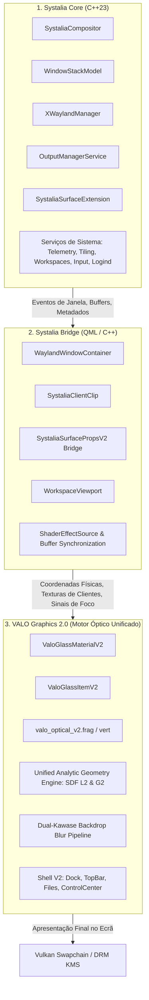
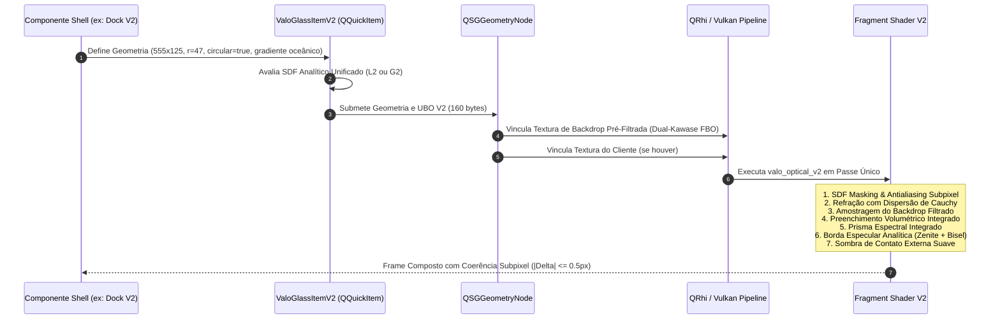

# Arquitetura do Sistema Gráfico — VALO Graphics 2.0

**Documento:** `docs/graphics-v2/ARCHITECTURE.md`  
**Data:** 07 de Novembro de 2026  
**Status:** Etapa 00 — Auditoria Arquitetural e Especificação Técnica  
**Branch:** `valo-graphics-2.0`  
**Stack Tecnológica:** C++23, Qt 6.11.2, Qt Quick Scene Graph, QRhi (Vulkan), GLSL 450 (SPIR-V), QtWayland Compositor  

---

## 1. Visão Geral e Separação em Três Camadas

O **VALO Graphics 2.0** estabelece uma separação rigorosa de responsabilidades no `systalia-glass-engine`, eliminando o acoplamento entre regras de gerenciamento de janelas e efeitos ópticos complexos. A arquitetura é dividida em três pilares fundamentais:



### 1.1 Camada 1: Systalia Core
- **Responsabilidade:** Compositor Wayland soberano, conformidade com os protocolos `xdg-shell`, gerenciamento de clientes XWayland, modelo de empilhamento Z-order, indexação de processos e comunicação D-Bus.
- **Isolamento:** Não conhece nós do Scene Graph, materiais ou shaders. Opera puramente com primitivas Wayland (`wl_surface`, `xdg_toplevel`), retângulos lógicos e serviços de sistema.

### 1.2 Camada 2: Systalia Bridge
- **Responsabilidade:** Tradução bidirecional entre o Core e a interface gráfica declarativa.
- **Componentes:**
  - `WaylandWindowContainer.qml`: gerencia o ciclo de vida da janela (mapeamento, redimensionamento, foco, maximização e destruição).
  - `SystaliaClientClip`: cálculo analítico das regiões de conteúdo dos clientes e insets da barra de título.
  - Sincronização atômica de buffers: apresentação direta do `ShellSurfaceItem` sem intermediários que possam causar perda de frames.

### 1.3 Camada 3: VALO Graphics 2.0
- **Responsabilidade:** Pipeline gráfico unificado de renderização de materiais ópticos translúcidos, refração, dispersão de Cauchy, sombras, bordas especulares e componentes da shell.
- **Princípio Mestre:** **Uma única definição geométrica por superfície.** Eliminação de camadas sobrepostas desenhando formas diferentes.

---

## 2. Pipeline de Superfície Unificada (Unified Surface Pipeline)

No sistema legado, uma única janela ou cápsula da Dock combinava até 5 itens gráficos concorrentes no Scene Graph: um `BorderImage` para sombra, um `SystaliaGlassItem` retangular com descarte em shader, e 3 itens `Shape` (`SystaliaG2Frame`) para gradiente, prisma e borda. Isso gerava divergências de curvatura de até 16.01 px e 4 chamadas de desenho redundantes.

No **VALO Graphics 2.0**, cada elemento gráfico adota um **Pipeline de Superfície Única**:



### 2.1 Requisitos e Métricas do Novo Motor Óptico
1. **Definição Única de Geometria:** Uma única matriz de parâmetros geométricos (`width`, `height`, `radii`, `slant`) governa o contorno, o preenchimento, o recorte óptico e a borda especular.
2. **SDF Compartilhado e Preciso:**  
   - Modo **$L_2$ Circular Analítico:** Utilizado na Dock e na TopBar para arcos de círculo euclidianos perfeitos.
   - Modo **$G_2$ Squircle Analítico:** Utilizado nas janelas de aplicativos para continuidade de curvatura suave ($C^2$).
3. **Métricas de Tolerância Perimétrica Justificadas:**
   - **Tolerância Analítica Contínua:** $|\Delta_{\text{analítico}}| < 0.01\text{ px}$ entre as equações do shader e do gerador vetorial de vértices.
   - **Tolerância de Rasterização Discreta:** $|\Delta_{\text{raster}}| \le 0.5\text{ px}$ físico, correspondente ao limiar natural de antialiasing subpixel em grades discretas de pixels (eliminando a discrepância histórica de 16.01 px da V1).
4. **Refração e Dispersão Cromática Integradas:** Amostragem do fundo através de vetor normal derivado do SDF, com dispersão de comprimento de onda (canais R, G e B amostrados com offsets angulares).
5. **Composição com Alpha Pré-Multiplicado (Premultiplied Alpha):**  
   - O pipeline opera estritamente com `fragColor = vec4(rgb * a, a)`.
   - Texturas de clientes Wayland utilizam formato premultiplied nativo; a mesclagem no shader preserva a integridade de transparência sem descoloração perimétrica ou halos pretos causados por un-premultiply incorreto.
6. **Coordenadas de Backdrop em Múltiplos Monitores:**
   - A amostragem de tela converte a posição global absoluta do fragmento em coordenadas normalizadas sobre o canvas virtual unificado gerenciado por `OutputManagerService::virtualCanvasBounds()`.
   - Isso elimina descontinuidades de refração ou repetição de UV em configurações multi-monitor ou monitores com orientações mistas.
7. **Estratégia de Atualização de Blur (Dirty Tracking):**
   - A pirâmide de FBOs do filtro Dual-Kawase é atualizada **apenas** quando o wallpaper for alterado, quando janelas abaixo da superfície translúcida se moverem ou quando houver animações em primeiro plano. Em repouso estático, os passes de blur são ignorados (dirty flag = false), reduzindo o consumo de energia a zero.
8. **Separação Rígida entre Conteúdo Wayland e Decorações:**
   - O buffer das aplicações clientes (`ShellSurfaceItem`) é preservado integralmente sem distorções, aberrações ópticas ou estiramentos.
   - A deformação física ou óptica é restrita à moldura decorativa externa (chassi de vidro), enquanto o viewport cliente é protegido por um scissor/stencil retangular analítico.

---

## 3. Avaliação Técnica: QSGMaterial vs. QSGRenderNode vs. QRhi Direto

Para definir o alicerce de renderização do VALO Graphics 2.0, realizamos uma comparação detalhada entre as três abordagens disponíveis no Qt 6.11.2:

| Critério de Engenharia | Abordagem 1: `QSGMaterial` / `QSGMaterialShader` | Abordagem 2: `QSGRenderNode` | Abordagem 3: QRhi Customizado Direto |
| :--- | :--- | :--- | :--- |
| **Integração com Qt Quick** | **Perfeita.** Nó nativo do Scene Graph (`QSGGeometryNode`). Respeita transformações, clipping e opacidade nativas. | **Boa.** Permite emitir comandos brutos de renderização, mas requer gerenciamento manual de matrizes e estados. | **Complexa.** Requer controlar render passes fora do fluxo padrão do Qt Quick Scene Graph. |
| **Controle de Pipeline de Shaders** | Alto através de SPIR-V compilado e UBOs std140 gerenciados por `updateUniformData`. | Total sobre a pipeline state (PSO) e rasterização. | Total absoluto sobre comandos Vulkan/RHI. |
| **Passes Múltiplos (ex: Blur)** | Requer FBOs auxiliares ou `ShaderEffectSource` para passes secundários de blur. | Pode executar múltiplos render passes internamente em FBOs alocados. | Excelente para cadeias complexas de pós-processamento (Dual-Kawase). |
| **Custo de Manutenção / Risco** | **Baixo.** API estável e suportada oficialmente pelo Qt 6 LTS. | **Médio.** Código verboso e suscetível a regressões entre versões menores do Qt. | **Alto.** Acoplamento profundo com estruturas internas mutáveis do QRhi. |
| **Desempenho em Vulkan/EGLFS** | **Excelente.** Utiliza o backend Vulkan QRhi configurado na aplicação sem overhead. | Excelente. | Excelente. |

### Decisão Arquitetural Justificada
- **Adotamos a Abordagem 1 (`QSGMaterial` / `QSGMaterialShader`) como base primária do motor V2**, complementada por um **gerenciador de passes Dual-Kawase** implementado via `QRhi` para gerar a pirâmide de texturas de blur do backdrop.
- **Justificativa:** O `QSGMaterial` garante compatibilidade transparente com os testes de integração do Qt Quick, respeita a Z-order do `WindowStackModel` e preserva a sincronização de janelas Wayland sem introduzir a fragilidade de manutenção de um `QSGRenderNode` completo.

---

## 4. Contrato de Memória GPU (C++ ↔ Shaders)

### 4.1 Contrato Legado V1 (Preservado Intocado)
A struct `SystaliaSurfaceProps` de 128 bytes em `src/gfx/SystaliaSurfaceProps.hpp` permanece **100% inalterada**, garantindo que nenhum teste ou componente legado sofra regressão durante a transição.

### 4.2 Novo Contrato V2: `SystaliaSurfacePropsV2`
Para atender aos requisitos avançados do VALO Graphics 2.0 (controle independente de sombra, espessura de borda especular em ponto flutuante, modo de geometria e modulação de verniz), projetamos a nova estrutura `SystaliaSurfacePropsV2`:

```cpp
// src/gfx/v2/SystaliaSurfacePropsV2.hpp
#pragma once

#include <QMatrix4x4>
#include <QVector4D>
#include <QVector2D>
#include <cstddef>

/**
 * @brief Bloco de dados uniformes V2 (std140 estrito, 160 bytes alinhados a 16 bytes).
 * Utilizado exclusivamente pelo pipeline de shaders valo_optical_v2.
 */
struct alignas(16) SystaliaSurfacePropsV2 {
    Matrix4x4_std140 matrix;               // offset 0,   tamanho 64 (Matriz MVP)
    QVector4D radii;                       // offset 64,  tamanho 16 (TL, TR, BL, BR em pixels)
    QVector2D windowSize;                  // offset 80,  tamanho 8  (Largura, Altura)
    QVector2D screenResolution;            // offset 88,  tamanho 8  (Resolução do Viewport)
    float slant = 0.0f;                    // offset 96,  tamanho 4  (Inclinação 3D)
    float ior = 1.25f;                     // offset 100, tamanho 4  (Índice de Refração)
    float chromaticDispersion = 0.040f;    // offset 104, tamanho 4  (Dispersão de Cauchy)
    float causticIntensity = 0.85f;        // offset 108, tamanho 4  (Intensidade das Cáusticas)
    float surfaceOpacity = 0.34f;          // offset 112, tamanho 4  (Opacidade do Vidro)
    float time = 0.0f;                     // offset 116, tamanho 4  (Tempo em segundos)
    float hasClientTexture = 0.0f;         // offset 120, tamanho 4  (Flag 0.0 ou 1.0)
    float titleBarHeight = 36.0f;          // offset 124, tamanho 4  (Altura da barra de título)
    // --- Novos parâmetros V2 ---
    float specularStrokeWidth = 1.25f;     // offset 128, tamanho 4  (Espessura da borda especular)
    float geometryMode = 0.0f;             // offset 132, tamanho 4  (0.0 = L2 Circular, 1.0 = G2 Squircle)
    float shadowIntensity = 0.35f;         // offset 136, tamanho 4  (Opacidade da sombra externa)
    float shadowOffsetY = 12.0f;           // offset 140, tamanho 4  (Deslocamento vertical da sombra)
    QVector4D volumetricTint = {0.03f, 0.18f, 0.32f, 0.39f}; // offset 144, tamanho 16 (Tonalização)
};

static_assert(sizeof(SystaliaSurfacePropsV2) == 160, "SystaliaSurfacePropsV2 deve ter exatamente 160 bytes");
static_assert(sizeof(SystaliaSurfacePropsV2) % 16 == 0, "Alinhamento deve ser múltiplo de 16");
static_assert(offsetof(SystaliaSurfacePropsV2, specularStrokeWidth) == 128);
static_assert(offsetof(SystaliaSurfacePropsV2, geometryMode) == 132);
static_assert(offsetof(SystaliaSurfacePropsV2, shadowIntensity) == 136);
static_assert(offsetof(SystaliaSurfacePropsV2, shadowOffsetY) == 140);
static_assert(offsetof(SystaliaSurfacePropsV2, volumetricTint) == 144);
```

---

## 5. Coordenadas, Espaços e Suporte a Múltiplos Monitores / HiDPI

O cálculo de refração em ecrãs estendidos e sob fatores fracionários de DPI (ex.: 1.25x, 1.5x) é uma das causas mais comuns de distorção óptica incorreta. No VALO Graphics 2.0:

1. **Separação entre Unidades Lógicas e Físicas:**
   - A geometria dos itens QML e as propriedades `radii`, `windowSize` e `strokeWidth` são mantidas em coordenadas lógicas orientadas pelo design do Figma.
   - O `devicePixelRatio` físico fornecido pelo `OutputManagerService` é transmitido ao shader para escalonar as derivadas analíticas `fwidth()` e calcular o anti-aliasing subpixel preciso.
2. **Screen-Space UV Mapping para Backdrop Multi-Monitor:**
   - Em configurações multi-monitor, a textura do desktop engloba o canvas virtual total.
   - O fragment shader calcula a coordenada UV do backdrop utilizando a posição absoluta em ecrã normalizada pelo `u_ScreenResolution`, evitando repetições ou quebras nas fronteiras de telas.

---

## 6. Gerenciamento Seguro de Recursos e VRAM

Para garantir operação de 60+ FPS sem vazamento de memória de vídeo ou picos de frametime:
- **FBO Pooling:** As texturas temporárias utilizadas para filtragem de blur e captura de janelas são alocadas em um pool reutilizável dimensionado pela resolução da tela, evitando `glGenTextures` / `vkCreateImage` contínuos durante o redimensionamento.
- **Occlusion Culling Ativo:** Janelas minimizadas ou fora do frustum do workspace ativo têm suas chamadas de pintura e atualizações de textura suprimidas (`shouldSuppressSceneGraphUpdate()`), liberando ciclos de GPU para o desktop ativo.

