# Plano de Migração Incremental — VALO Graphics 2.0

**Documento:** `docs/graphics-v2/MIGRATION_PLAN.md`  
**Data:** 07 de Novembro de 2026  
**Status:** Etapa 00 — Planejamento de Engenharia e Migração  
**Branch:** `valo-graphics-2.0`  
**Objetivo Estratégico:** Substituir progressivamente o motor gráfico legado sem interromper o compositor Wayland, sem quebrar os 36 testes automatizados existentes e sem misturar pipelines concorrentes sobre a mesma superfície.

---

## 1. Estratégia de Coexistência em Pipeline Duplo (Dual-Pipeline Architecture)

A transição para o **VALO Graphics 2.0** adota um modelo de **desenvolvimento em paralelo isolado**. A implementação antiga continuará totalmente funcional e passível de execução enquanto a nova arquitetura é construída em diretórios e namespaces dedicados:

```text
systalia-glass-engine/
├── shaders/
│   ├── valo_optical.frag           # [V1] Shader de produção legado (intocado)
│   ├── valo_optical.vert           # [V1] Vertex shader legado (intocado)
│   └── v2/                         # [V2] Novos shaders isolados
│       ├── valo_optical_v2.frag    # [V2] Fragment shader unificado
│       ├── valo_optical_v2.vert    # [V2] Vertex shader unificado
│       ├── valo_kawase_down.frag   # [V2] Filtro Dual-Kawase (Downsampling)
│       └── valo_kawase_up.frag     # [V2] Filtro Dual-Kawase (Upsampling)
├── src/
│   ├── gfx/
│   │   ├── SystaliaGlassItem.*     # [V1] Item legado (intocado)
│   │   ├── SystaliaGlassMaterial.* # [V1] Material legado (intocado)
│   │   ├── SystaliaSurfaceProps.hpp# [V1] UBO std140 128 bytes (intocado)
│   │   └── v2/                     # [V2] Novo subsistema C++
│   │       ├── ValoGlassItemV2.*   # [V2] Item QQuickItem unificado
│   │       ├── ValoGlassMaterialV2.* # [V2] Material com UBO V2 de 160 bytes
│   │       ├── SystaliaSurfacePropsV2.hpp # [V2] Nova struct de uniformes
│   │       └── ValoBlurPipelineV2.* # [V2] Gerenciador de passes Dual-Kawase
│   └── qml/
│       ├── ValoGlass.qml           # [V1] Componente de vidro legado
│       └── graphics/v2/            # [V2] Componentes visuais reconstruídos
│           ├── ValoSurfaceV2.qml   # [V2] Casca única de material e geometria
│           └── ValoDockV2.qml      # [V2] Protótipo da Dock isolado
```

### 1.1 Chave de Seleção e Mecanismo de Fallback
Para permitir alternância instantânea entre os motores e possibilitar testes A/B determinísticos:
- **Build-time:** Configuração CMake `-DSGE_GRAPHICS_V2=ON/OFF` (padrão inicial: `OFF` nos testes de regressão antigos, `ON` nos novos alvos).
- **Runtime:** Propriedade QML global `ValoTheme.graphicsEngineVersion` ("v1" ou "v2") e variável de ambiente de depuração `SGE_FORCE_GRAPHICS_V2=1`.
- **Garantia de Não-Interferência:** O motor V2 nunca será ativado sobre a mesma superfície que o motor V1. Não haverá acúmulo de blurs ou contornos duplicados.

---

## 2. Primeiro Protótipo de Validação: Dock VALO V2

Conforme estabelecido pela especificação arquitetural, a **Dock** foi eleita como o primeiro componente para validação ponta a ponta do motor V2 por reunir todos os desafios visuais do projeto:
- **Geometria:** 555 × 125 px com cantos circulares analíticos $R=47\text{ px}$.
- **Composição Óptica:** Vidro translúcido oceânico com refração $IOR = 1.25$, dispersão de Cauchy ($\Delta = 0.040$) e cáusticas ativas.
- **Acabamento Especular:** Borda única contínua de 1.25 px de espessura.
- **Sombra de Contato:** Sombra suave externa independente projetada abaixo da base.
- **Cinco Lançadores Vetoriais:** Arquivos, Áudio, Terminal, IDE e Core nas posições exatas do Figma.

### 2.1 Os 8 Passes Diagnósticos do Protótipo
O protótipo da Dock V2 será construído permitindo a inspeção isolada de cada passe de renderização através de flags de diagnóstico (`debugPass: "A" .. "H"`):
1. **Passe 1 — Geometria SDF Analítica:** Validação do mapa de distâncias euclidiano $L_2$.
2. **Passe 2 — Máscara Perimétrica:** Recorte com derivadas `fwidth` e antialiasing subpixel.
3. **Passe 3 — Preenchimento Volumétrico:** Gradiente oceânico triplo integrado.
4. **Passe 4 — Refração do Backdrop:** Deslocamento normal com IOR.
5. **Passe 5 — Blur Dual-Kawase:** Amostragem da pirâmide de texturas desfocadas.
6. **Passe 6 — Contorno Especular:** Iluminação de bisel e reflexo zenital de 1.25 px.
7. **Passe 7 — Sombra Externa:** Oclusão suave sem interferência interna no vidro.
8. **Passe 8 — Composição Final:** Integração unificada no Scene Graph com os 5 ícones vetoriais.

---

## 3. Cronograma Incremental de Implementação (Etapas 00 a 08)

```mermaid
flowchart LR
    E00[Etapa 00: Auditoria e Arquitetura] --> E01[Etapa 01: Fundação V2 e Geometria SDF]
    E01 --> E02[Etapa 02: Materiais e Máscaras V2]
    E02 --> E03[Etapa 03: Dual-Kawase Blur e Refração]
    E03 --> E04[Etapa 04: Protótipo Dock V2]
    E04 --> E05[Etapa 05: Reconstrução da Shell QML]
    E05 --> E06[Etapa 06: Decorações Wayland e XWayland]
    E06 --> E07[Etapa 07: Otimização e Perfis Gráficos]
    E07 --> E08[Etapa 08: Validação e Decomissionamento V1]
```



### Detalhamento das Etapas

#### Etapa 00 — Auditoria Arquitetural e Planejamento (CONCLUÍDA NESTA EXECUÇÃO)
- **Escopo:** Inventário dos módulos, auditoria do sistema gráfico legado, auditoria cruzada Figma × CSS × Tokens, desenho da arquitetura tripartite e estratégia de migração.
- **Critério de Saída:** Documentação completa em `docs/graphics-v2/` aprovada e suíte de testes CTest 100% verde (36/36).

#### Etapa 01 — Fundação do VALO Graphics V2 e Sistema Geométrico Analítico
- **Escopo:** Criação de `src/gfx/v2/SystaliaSurfacePropsV2.hpp`, `ValoGeometryEngineV2` (cálculo de SDF $L_2$ e $G_2$ analítico) e novos alvos de compilação CMake.
- **Entregas:** Testes unitários de geometria matemática (`tst_SdfGeometryMathV2`) comprovando erro $< 0.01\text{ px}$.

#### Etapa 02 — Renderização de Materiais e Máscaras V2
- **Escopo:** Implementação de `ValoGlassMaterialV2` e `ValoGlassItemV2` com shader `valo_optical_v2.frag` básico executando recorte e antialiasing em passe único.
- **Entregas:** Renderização de superfícies com alfa pré-multiplicado e contorno especular unificado.

#### Etapa 03 — Dual-Kawase Backdrop Blur, Refração e Efeitos Ópticos V2
- **Escopo:** Implementação do pipeline de blur Dual-Kawase em múltiplos FBOs reduzidos, amostragem refrativa com dispersão de Cauchy e cáusticas animadas.
- **Entregas:** Teste de fidelidade óptica e medição de frametime estável em 60 FPS no perfil Balanced.

#### Etapa 04 — Protótipo Isolado da Dock VALO V2 e Validação Visual
- **Escopo:** Construção do componente `ValoDockV2.qml` utilizando o novo motor óptico, os 5 ícones vetoriais do Figma e os 8 passes diagnósticos.
- **Entregas:** Validação dos 7 estados interativos da Dock e aprovação visual em comparação direta com o Figma.

#### Etapa 05 — Reconstrução dos Componentes QML da Shell
- **Escopo:** Migração da `SystaliaTopBar.qml` (preservando o layout atual), `SystaliaFilesWindow.qml` e `SystaliaControlCenter.qml` para a infraestrutura V2.
- **Entregas:** Shell completa operando com a nova identidade estética do Figma sem duplicação de bordas.

#### Etapa 06 — Integração com Decorações de Janelas Wayland e XWayland
- **Escopo:** Conexão do contêiner de janelas `WaylandWindowContainer.qml` ao `ValoSurfaceV2`, garantindo atomicidade de apresentação de buffers e suporte ao protocolo `z_systalia_surface_v1`.
- **Entregas:** Testes E2E com Alacritty, VS Code e aplicações XWayland aprovados com superfícies 100% visíveis e redimensionamento fluido.

#### Etapa 07 — Otimização de Performance, Perfis Gráficos e Interações
- **Escopo:** Calibração dos perfis Quality, Balanced e Performance, pooling de texturas QRhi e microinterações táteis de hover e press.
- **Entregas:** Testes de stress de VRAM sem vazamentos e benchmarks de telemetria de FPS.

#### Etapa 08 — Validação Final, Decomissionamento Seguro e Limpeza
- **Escopo:** Retirada dos componentes obsoletos em `src/gfx/` legado, consolidação do `ValoGlass.qml` e documentação final de encerramento da V2.
- **Entregas:** Suíte completa de testes atualizada para o motor V2 com 100% de aprovação.

