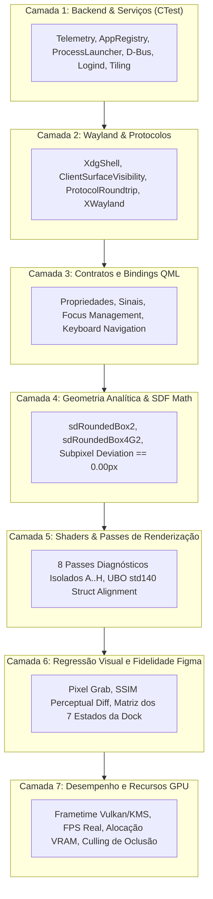

# Estratégia de Testes, Qualidade e Benchmarking — VALO Graphics 2.0

**Documento:** `docs/graphics-v2/TEST_STRATEGY.md`  
**Data:** 07 de Novembro de 2026  
**Status:** Etapa 00 — Planejamento de Qualidade e Validação  
**Branch:** `valo-graphics-2.0`  
**Meta de Qualidade:** Preservar 100% de aprovação na suíte CTest existente e estabelecer testes determinísticos de fidelidade visual baseados em inspeção real de pixels.

---

## 1. Princípios e Separação em Sete Camadas de Teste

Para evitar testes frágeis que apenas verificam nomes de strings ou propriedades sintáticas sem avaliar o que o usuário realmente enxerga na tela, o **VALO Graphics 2.0** adota uma suíte estruturada em **sete camadas independentes de validação**:

---

## 2. Inventário e Mapeamento das Suítes Existentes (36/36 CTest)

Nenhum teste existente será descartado ou enfraquecido. A tabela abaixo mapeia as suítes atuais e estabelece seus papéis de salvaguarda:

| Categoria de Teste | Suíte / Alvo CTest | O Que Valida | Salvaguarda na V2 |
| :--- | :--- | :--- | :--- |
| **Compositor / Protocolo** | `tst_xdg_shell`, `tst_wayland_socket`, `tst_systalia_protocol`, `tst_protocol_roundtrip` | Criação de sockets Wayland, handshake de protocolos e despacho de eventos | Garante que a transição gráfica não afete a conectividade Wayland |
| **Visibilidade de Clientes**| `tst_client_surface_visibility`, `tst_wayland_client_lifecycle_e2e` | Apresentação de buffers de aplicações reais (Alacritty, VS Code) e XWayland | **Crítico:** Impede regressão de telas pretas ou janelas invisíveis |
| **Serviços de Sistema** | `tst_telemetry`, `tst_process_launcher`, `tst_app_registry`, `tst_notification_server`, `tst_logind_integration` | Parsers de `/proc`, disparo de apps `.desktop`, D-Bus e sessões | Preserva toda a camada de infraestrutura Linux |
| **Janelas e Tiling** | `tst_liquid_tiling`, `tst_xdg_resize`, `tst_workspace_manager`, `tst_task_switcher` | Partição em árvore de mosaico, redimensionamento interativo e 4 workspaces | Assegura estabilidade dimensional em janelas dinâmicas |
| **Geometria e Memória** | `tst_sdf_geometry`, `tst_sdf_geometry_math`, `tst_memory_alignment` | Fórmulas matemáticas de distância analítica e alinhamento de 128 bytes | Validações analíticas de precisão geométrica |
| **Design System e Tema** | `tst_valo_theme`, `tst_valo_decorations` | 124 tokens VALO e botões de controle de janela | Garante integridade absoluta dos tokens homologados |
| **Regressão da Shell** | `tst_shell_state_regression` | Estrutura da TopBar, Dock e captura dos 7 estados obrigatórios | Base de comparação visual direta |

---

## 3. Testes Visuais, Métricas Perimétricas e Acessibilidade

Ao contrário de testes unitários convencionais que apenas avaliam valores numéricos em memória, os testes visuais da V2 operam diretamente sobre o frame buffer renderizado pelo Scene Graph (`QQuickWindow::grabWindow()`) e sobre o analisador de acessibilidade:

### 3.1 Critérios de Tolerância Geométrica Justificados
- **Tolerância Analítica Contínua:** $|\Delta_{\text{analítico}}| < 0.01\text{ px}$ no espaço contínuo entre as fórmulas SDF e as curvas de vértices.
- **Tolerância de Rasterização Discreta:** $|\Delta_{\text{raster}}| \le 0.5\text{ px}$ físico, correspondente ao limiar natural de antialiasing subpixel em grades discretas de pixels.
- **Verificação Automatizada:** Scripts automatizados em Python/Pillow executam testes de máscara de cor (Overlay Vermelho = SDF, Verde = Borda, Azul = Blur, Amarelo = Gradiente) comprovando a eliminação do desvio histórico de 16.01 px da V1.

### 3.2 Validação de Contraste e Acessibilidade (Lucid & Adaptive)
- **Contraste WCAG AA:** Teste de luminância relativa que calcula $CR = (L_1 + 0.05) / (L_2 + 0.05)$ sobre amostras de texto e ícones contra o material translúcido. Aprovado apenas se $CR \ge 4.5:1$ para texto regular e $\ge 3.0:1$ para títulos e glifos.
- **Redução de Movimento:** Validação de que ao alternar `ValoOpticalContext::prefersReducedMotion = true`, a taxa de atualização de $u\_Time$ é zerada e as molas físicas realizam salto direto para o estado de repouso, sem oscilação.
- **Sincronização de Hit-Test (Organic):** Teste de coordenadas de clique simuladas comprovando que durante o arraste de janela (`drag slant`), o cursor do mouse e a região de entrada Wayland coincidem exatamente sem descolamento perceptível.

---

## 4. Matriz de Validação dos Três Perfis Gráficos

O VALO Graphics 2.0 fornece três perfis operacionais com características bem definidas:

| Característica Gráfica | Perfil Quality | Perfil Balanced (Padrão) | Perfil Performance |
| :--- | :---: | :---: | :---: |
| **Refração Óptica** | $IOR = 1.25$ pleno com offset de 45 px | $IOR = 1.15$ com offset de 25 px | $IOR = 1.00$ (Sem distorção refrativa) |
| **Dispersão Cromática** | $\Delta = 0.040$ (Cauchy triplo R, G, B) | $\Delta = 0.026$ (Dispersão moderada) | $\Delta = 0.000$ (Sem dispersão) |
| **Cáusticas Subaquáticas** | Animadas contínuas por `u_Time` | Animadas em baixa frequência (30 FPS) | Desativadas (Tonalização estática) |
| **Backdrop Blur** | Dual-Kawase 4 passes com pirâmide FBO | Dual-Kawase 2 passes | Amostragem estática simples |
| **Borda Especular** | 1.25 px com bisel zenital iluminado | 1.25 px contínua | 1.0 px lisa |
| **Alvo de Desempenho** | GPUs Dedicadas / Vulkan KMS (60+ FPS) | iGPUs Intel/AMD modernas (60 FPS) | Hardwares legados ou modo economia de energia |

---

## 5. Procedimentos de Validação e Critérios de Aceite para Início da Etapa 01

A Etapa 01 (Fundação do VALO Graphics V2 e Sistema Geométrico) somente será iniciada se os seguintes critérios forem estritamente atendidos:

1. [x] **Branch Verificada:** Trabalho conduzido exclusivamente na branch `valo-graphics-2.0`.
2. [x] **Árvore Limpa:** Nenhuma modificação local perdida e histórico de commits preservado.
3. [x] **Tokens Homologados:** Todos os 124 tokens VALO verificados em `valo.tokens.json`, `ValoTokens.hpp` e `ValoTheme.qml`.
4. [x] **Suíte CTest Aprovada:** 36/36 testes passando (100% verde).
5. [x] **Documentação de Engenharia Concluída:** Documentos `ARCHITECTURE.md`, `LEGACY_AUDIT.md`, `FIGMA_CSS_TOKENS_AUDIT.md`, `MIGRATION_PLAN.md` e `TEST_STRATEGY.md` finalizados em `docs/graphics-v2/`.
6. [x] **Sem Regressões Funcionais:** Compositor Wayland, XWayland e serviços de sistema 100% funcionais.

