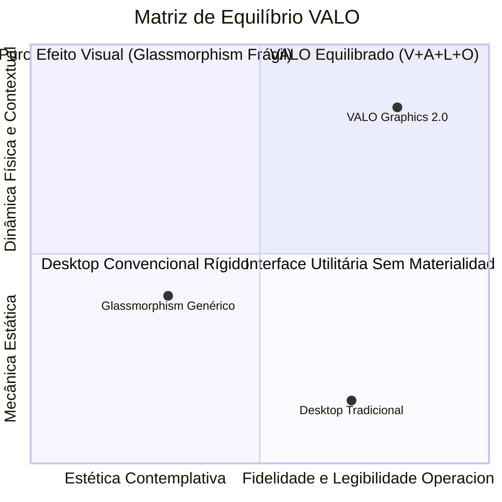
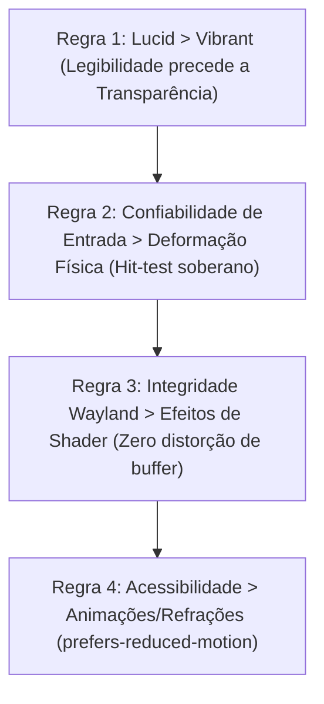
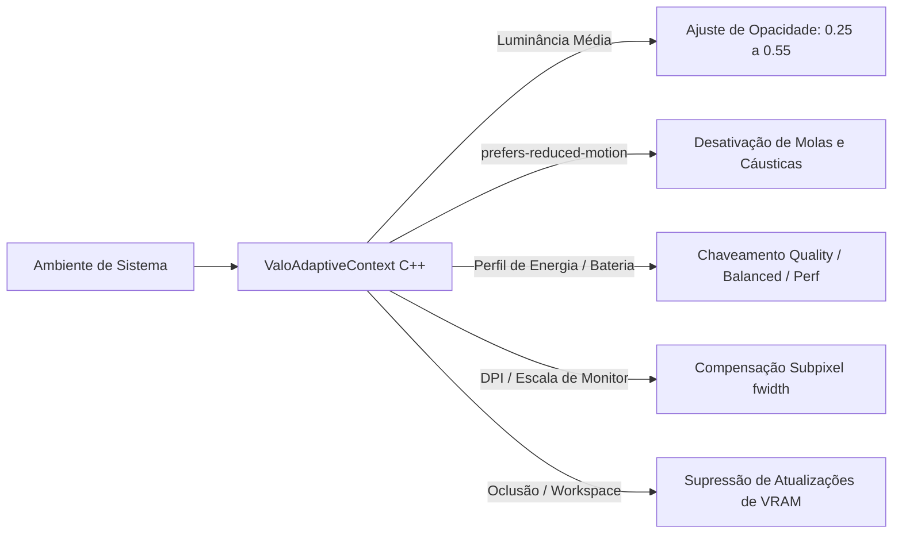

# Filosofia de Design e Engenharia — VALO (Vibrant, Adaptive, Lucid, Organic)

**Documento:** `docs/graphics-v2/VALO_DESIGN_PHILOSOPHY.md`  
**Data:** 07 de Novembro de 2026  
**Status:** Etapa 00.1 — Consolidação Arquitetural dos Pilares VALO  
**Branch:** `valo-graphics-2.0`  
**Escopo:** Diretrizes de Design, Princípios de UX, Contratos de Engenharia Gráfica e Critérios de Acessibilidade  

---

## 1. O Manifesto VALO

O ecossistema **SYSTALIA — VALO** não é uma simples camada estética de "glassmorphism" ou um empilhamento de shaders de desfoque translúcido. VALO é um paradigma holístico de interface desktop fundamentado no acrônimo:

$$\mathbf{V}\text{ (Vibrant)} \quad\times\quad \mathbf{A}\text{ (Adaptive)} \quad\times\quad \mathbf{L}\text{ (Lucid)} \quad\times\quad \mathbf{O}\text{ (Organic)}$$



### Definição Formal dos Quatro Pilares

| Pilar | Conceito Central | Tradução em Engenharia Visual | Anti-Padrão a Evitar |
| :--- | :--- | :--- | :--- |
| **V — Vibrant** | Superfícies digitais vivas com materialidade óptica rica, luz zenital, reflexos espectrais e dispersão de Cauchy. | Shader óptico unificado, IOR físico ($1.00$ a $1.25$), arco prismático a $-31^\circ$, cáusticas moduladas por energia. | Efeitos estáticos de "vidro fumê", estrias opacas ou texturas borradas sem vida. |
| **A — Adaptive** | Reatividade contínua ao contexto: luminância do wallpaper, estado da janela, escala HiDPI e economia de bateria. | Ajuste dinâmico de opacidade ($0.25 \dots 0.55$), dirty tracking, culling de oclusão e perfis Quality/Balanced/Performance. | Coleta de telemetria comportamental invasiva, I.A. opaca ou sobrecarga térmica descontrolada. |
| **L — Lucid** | Clareza absoluta de leitura, contraste acessível WCAG AA e integridade inviolável do conteúdo de clientes. | Fallback semi-opaco automático em fundos ruidosos, preservação pixel-perfect dos buffers Wayland. | Texto ilegível sobre fundo claro, halos ofuscantes ou distorção dos pixels das aplicações. |
| **O — Organic** | Física viscoelástica, movimento com inércia de mola amortecida e geometria analítica contínua. | Equações diferenciais de mola ($F = -kx - cv$), flexão elástica durante o arraste e cantos $L_2$ e $G_2$ perfeitos. | Deformação elástica do conteúdo do cliente, saltos visuais secos ou incompatibilidade com hit-testing. |

---

## 2. Princípios de UX e Regras de Prioridade em Conflitos

Quando requisitos estéticos e operacionais entrarem em atrito, a engine deve seguir esta **ordem estrita de precedência**:



1. **Regra 1 (Lucid > Vibrant):** Se a luminância ou a complexidade de alta frequência do papel de parede comprometer o contraste do texto (relação $< 4.5:1$), a opacidade da superfície é automaticamente elevada (de $0.34$ para até $0.65$), garantindo legibilidade imediata sem desativar a identidade VALO.
2. **Regra 2 (Entrada Soberana > Deformação Orgânica):** A deformação física de arrasto (flexão angular de até $1.5^\circ$) é estritamente cosmética na moldura. A região interativa de entrada (`wl_surface.set_input_region`) e os limites de clique nunca se descolam do ponteiro do mouse.
3. **Regra 3 (Integridade de Cliente > Efeitos Ópticos):** O buffer fornecido por clientes Wayland (Alacritty, VS Code, navegadores) é sagrado. O shader não aplica aberração cromática, refração ou deformação no retângulo interior da aplicação; esses efeitos são restritos às bordas chanfradas, barras de título e chassis externos.
4. **Regra 4 (Acessibilidade e Redução de Movimento):** Ao detectar a configuração do sistema `prefers-reduced-motion` ou modo de Alto Contraste, as cáusticas animadas e as oscilações de mola são instantaneamente substituídas por transições estáticas ou cortes suaves de opacidade.

---

## 3. Vibrant — Sistema Óptico Contextual e Físico

O pilar **Vibrant** transcende uma cor translúcida estática. Ele confere vida mineral à interface digital através de modelos ópticos com rigor físico:

### 3.1 Modelo de Refração e Dispersão de Cauchy
A refração de fundo amostra a textura de desktop através do gradiente normal analítico do SDF:
$$\vec{n} = \frac{\nabla \text{SDF}(\vec{p})}{\|\nabla \text{SDF}(\vec{p})\|}$$
O vetor de deslocamento refrativo $\vec{d}_{\text{refr}}$ é modulado pela curvatura do menisco periférico e pelo índice de refração $IOR \in [1.00, 1.25]$:
$$\vec{d}_{\text{refr}} = \vec{n} \cdot (IOR - 1.0) \cdot \text{menisco}(d)$$

A dispersão cromática decompõe a luz refratada em três comprimentos de onda discretos segundo a aproximação de Cauchy:
$$\vec{d}_R = \vec{d}_{\text{refr}} + \vec{n} \cdot \Delta_{\text{disp}}, \quad \vec{d}_G = \vec{d}_{\text{refr}}, \quad \vec{d}_B = \vec{d}_{\text{refr}} - \vec{n} \cdot \Delta_{\text{disp}}$$
onde $\Delta_{\text{disp}} = 0.040$ no perfil Quality e $0.026$ no perfil Balanced.

### 3.2 Prisma Espectral e Reflexo Zenital
- **Ângulo Prismático:** Fixado em $-31^\circ$ (conforme especificação original do Figma) com paradas nas cores Ciano (`#00EFFF` @ 0.10), Branco Gelo (`#F5FFFF` @ 0.12), Âmbar Dourado (`#F8C47B` @ 0.07) e Violeta Cósmico (`#9E77FF` @ 0.08).
- **Luz Zenital da Borda (Rim Light):** A iluminação perimétrica é proporcional ao produto escalar entre a normal da superfície e a fonte de luz zenital superior $\vec{L} = (0, -1)$:
$$\text{zenith} = \max(-\vec{n}_y, 0.0)$$

### 3.3 Cáusticas Subaquáticas Controladas por Dirty State
- As cáusticas simulam a incidência de feixes de luz solar através de ondas aquáticas superficiais via três funções trigonométricas combinadas.
- **Eficiência Energética:** Para evitar consumo contínuo de ciclos GPU quando a interface estiver ociosa:
  - As cáusticas animam a 60 FPS apenas quando há interação de ponteiro ou aplicativos ativos.
  - Em repouso prolongado ($> 5\text{ s}$ sem eventos), a taxa de avanço temporal $u\_Time$ reduz suavemente para 15 FPS ou congela num frame estável de alta estética, despertando instantaneamente ao primeiro evento de entrada.

---

## 4. Adaptive — Adaptação Contextual e Sensibilidade ao Ambiente

O pilar **Adaptive** dota o compositor da capacidade de harmonizar a interface com as condições de exibição, hardware e preferências do utilizador:



### 4.1 Adaptação à Luminância do Wallpaper
- O motor analisa a luminância média relativa $Y = 0.2126 R + 0.7152 G + 0.0722 B$ da região do desktop coberta pela janela:
  - **Wallpaper Escuro ($Y < 0.25$):** Opacidade mínima calibrada em $0.34$, destacando refrações ciano.
  - **Wallpaper Médio ($0.25 \le Y \le 0.60$):** Opacidade equilibrada de $0.41$.
  - **Wallpaper Claro ou Ruidoso ($Y > 0.60$):** A opacidade do chassi eleva-se progressivamente para até $0.55$, e a cor do texto/ícones faz transição para contraste escuro ou adiciona uma placa de fundo fosca.

### 4.2 Estados Ativo, Inativo e Oclusão
- **Janela Focada / Ativa:** Borda especular a 100% de intensidade, refração plena, prisma ativo.
- **Janela Inativa:** Intensidade de borda reduzida em 60%, dispersão cromática reduzida a zero, supressão de cáusticas.
- **Janela Ocluída ou Minimizada:** O método `shouldSuppressSceneGraphUpdate()` interrompe qualquer emissão de comandos de pintura na GPU.

### 4.3 Garantia de Privacidade e Desempenho Local
- Toda a adaptação contextual é computada **localmente em tempo real via buffers gráficos e sensores locais de hardware**.
- É estritamente proibida a criação de telemetria persistente de hábitos do usuário, rastreamento de digitação ou processos em segundo plano de aprendizado automático para personalização de interface.

---

## 5. Lucid — Clareza, Ergonomia e Eficiência Operacional

A transparência jamais deve ser um obstáculo à produtividade. O pilar **Lucid** estabelece as barreiras de legibilidade e ergonomia visual:

### 5.1 Regras de Contraste WCAG AA
- Todos os textos e ícones informativos devem manter uma razão de contraste mínima de **4.5:1** contra o fundo imediato da sua cápsula ou painel.
- Elementos gráficos secundários e bordas estruturais devem manter razão de contraste de ao menos **3.0:1**.

### 5.2 Limitação de Halos e Poluição Visual
- O brilho de seleção (glow) e sombras luminosas são estritamente contidos por decaimento exponencial ($e^{-d^2/\sigma^2}$), evitando o "sangramento" de luz que ofusca controles vizinhos.
- Textos em barras de título e menus nunca recebem blur ou refração; seus pixels são rasterizados diretamente no buffer de topo sobre fundo de alto contraste.

---

## 6. Organic — Geometria Contínua, Deformação e Física de Molas

O pilar **Organic** remove a rigidez mecânica dos desktops tradicionais, conferindo resposta elástica coerente:

### 6.1 Os Quatro Domínios Arquiteturais Estritos (Organic Boundaries)

Para viabilizar física fluida sem corromper a precisão de janelas ou gerar descolamentos de clique, a arquitetura divide a representação de cada janela em **quatro domínios desacoplados**:

```mermaid
flowchart TD
    subgraph D1 ["Domínio 1: Geometria Lógica do Compositor"]
        LPos["Posição Lógica (X, Y)"]
        LSize["Dimensões Lógicas (Width, Height)"]
        LTiling["Árvore de Mosaico (LiquidTilingService)"]
        LProto["Contratos Wayland (xdg_toplevel / xdg_surface)"]
    end

    subgraph D2 ["Domínio 2: Transformação Visual Orgânica (Casca Externa)"]
        VSpring["Simulador de Mola (Deslocamento Inercial dx, dy)"]
        VSlant["Flexão Angular de Arraste (Slant 3D theta <= 1.5 deg)"]
        VScale["Escala Elástica de Feedback (0.94x a 1.08x)"]
    end

    subgraph D3 ["Domínio 3: Máscara, Material e Refração"]
        VSdf["Função de Distância Analítica (L2 / G2)"]
        VNorm["Normais de Refração Suave"]
        VStroke["Borda Especular de 1.25px"]
    end

    subgraph D4 ["Domínio 4: Região Interativa e Hit-Testing"]
        VInput["wl_surface.set_input_region"]
        VPointer["Mapeamento Absoluto de Ponteiro"]
        VClick["Contratos de Clique e Arraste sem Atraso"]
    end

    D1 --> D4
    D1 --> D2
    D2 --> D3
    Note over D2: Deformação restrita à casca de vidro externa.<br/>O conteúdo de clientes Wayland permanece 100% plano e nítido.
```

### 6.2 Física de Mola Amortecida (Spring-Damper Physics)
As microinterações da Dock (hover com ampliação fluida, clique com compressão elástica) e o movimento de arrasto de janelas utilizam o modelo harmônico amortecido:
$$m \frac{d^2 x}{dt^2} + c \frac{dx}{dt} + k (x - x_{\text{alvo}}) = 0$$
- **Rigidez ($k$):** Alta rigidez para resposta rápida ($k \approx 300\text{ N/m}$).
- **Amortecimento ($c$):** Calibrado para regime ligeiramente sub-amortecido ($\zeta \approx 0.82$), gerando um retorno tátil satisfatório sem oscilações infinitas.

### 6.3 Flexão Suave em Arraste (Window Drag Slant)
- Durante o arraste rápido de uma janela pelo mouse, a moldura de vidro sofre uma inclinação angular analítica sutil ($\theta \le 1.5^\circ$) proporcional à velocidade vetorial $\vec{v}_{\text{cursor}}$:
$$\text{slant} = \text{clamp}\left(\frac{\vec{v}_x}{v_{\text{max}}} \cdot 0.08, -0.025, 0.025\right)$$
- **Preservação de Conteúdo:** O conteúdo cliente (`ShellSurfaceItem`) **não é deformado**, apenas o chassi e as normais refrativas reagem ao movimento.

---

## 7. Contratos Conceituais de Engenharia

### 7.1 Contrato C++: `ValoOpticalContext`
```cpp
// src/gfx/v2/ValoOpticalContext.hpp
#pragma once
#include <QObject>
#include <QColor>
#include <QVector2D>

class ValoOpticalContext : public QObject {
    Q_OBJECT
    Q_PROPERTY(float ambientLuminance READ ambientLuminance NOTIFY ambientLuminanceChanged)
    Q_PROPERTY(float adaptiveOpacityOffset READ adaptiveOpacityOffset NOTIFY adaptiveOpacityOffsetChanged)
    Q_PROPERTY(bool prefersReducedMotion READ prefersReducedMotion NOTIFY prefersReducedMotionChanged)
    Q_PROPERTY(bool highContrastEnabled READ highContrastEnabled NOTIFY highContrastEnabledChanged)
    Q_PROPERTY(float energySavingFactor READ energySavingFactor NOTIFY energySavingFactorChanged)

public:
    explicit ValoOpticalContext(QObject *parent = nullptr);

    float ambientLuminance() const noexcept { return m_ambientLuminance; }
    float adaptiveOpacityOffset() const noexcept { return m_adaptiveOpacityOffset; }
    bool prefersReducedMotion() const noexcept { return m_prefersReducedMotion; }
    bool highContrastEnabled() const noexcept { return m_highContrastEnabled; }
    float energySavingFactor() const noexcept { return m_energySavingFactor; }

signals:
    void ambientLuminanceChanged();
    void adaptiveOpacityOffsetChanged();
    void prefersReducedMotionChanged();
    void highContrastEnabledChanged();
    void energySavingFactorChanged();

private:
    float m_ambientLuminance = 0.15f;
    float m_adaptiveOpacityOffset = 0.0f;
    bool m_prefersReducedMotion = false;
    bool m_highContrastEnabled = false;
    float m_energySavingFactor = 1.0f;
};
```

---

## 8. Critérios Mensuráveis de Aceitação dos Pilares VALO

| Pilar | Critério de Aceitação | Métrica de Verificação | Método de Teste |
| :--- | :--- | :--- | :--- |
| **Vibrant** | Borda especular contínua e refração com dispersão perceptível. | 0 duplicações visuais perimétricas. Bisel com pico zenital $\ge 0.85$ de intensidade. | Análise espectral de canais RGB no grab de janela. |
| **Adaptive** | Adaptação automática à luminância e respeito à redução de movimento. | Opacidade ajustada dinamicamente entre $0.25$ e $0.55$. Animações congeladas quando `reduced-motion = true`. | Suíte `tst_ValoAdaptiveContext` com injeção de wallpaper simulado. |
| **Lucid** | Contraste de texto conforme WCAG AA e integridade de janelas Wayland. | Razão de contraste $\ge 4.5:1$. 100% dos pixels do cliente nítidos sem aberração interna. | Teste de visibilidade `tst_ClientSurfaceVisibility` com padrão de teste visual. |
| **Organic** | Coerência perimétrica subpixel e microinterações de mola sem descolamento. | Desvio perimetral $|\Delta| \le 0.5\text{ px}$. Hit-test $100\%$ coincidente com área lógica. | Medição por overlay de máscara técnica e simulação de cliques `tst_ShellStateRegression`. |

